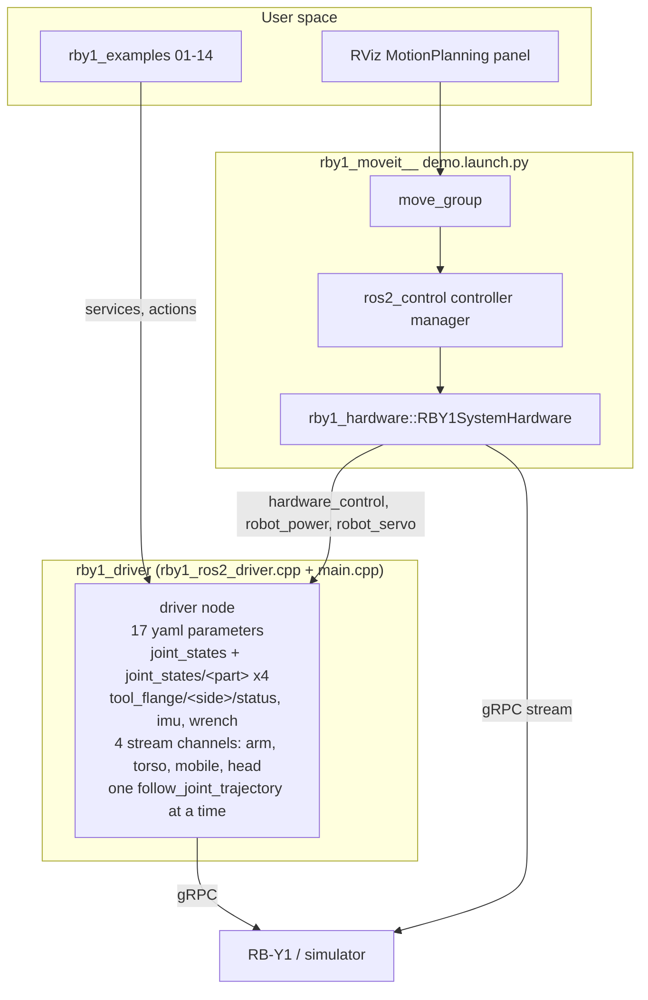
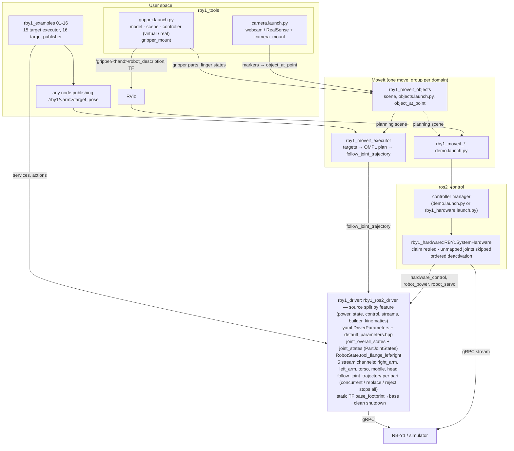

# Architecture: upstream `RainbowRobotics/rby1-ros2` → this repository (2026-10-30)

Compared with the public repository (`main`, read 2026-10-30): its packages are `rby1_driver` (two source files),
`rby1_msgs`, `rby1_examples` (01–14), `rby1_description`, `rby1_hardware`, `rby1_moveit/rby1_moveit_{a,m}_*` (7 MoveIt
configurations with `demo.launch.py`) and `rby1_navigation`; its documentation is the README and one controller guide.

## Before

- The gripper: not in the URDFs (up to v1.2) and not in the scene; v1.3's URDF had it but no controller fed its joints.
- No planner driven by targets, no planning-scene tools, no camera or gripper tools, no integrated launch.
- Driver limits were yaml keys (`minimum_time`, velocity limits, `stop_*_tracking_error`, `get_state_period`, `fault_reset_trigger`).

## Now

## What changed, by package

| Area | Upstream | Now |
|---|---|---|
| Driver source | `rby1_ros2_driver.cpp` + `main.cpp` | Split by feature: `power.cpp`, `state_manager.cpp`, `control.cpp`, `control_stream.cpp`, `command_builder.cpp`, `kinematics.cpp`, included by `rby1_ros2_driver.cpp`; fixed values in `default_parameters.hpp` |
| Parameters | 17 yaml keys, limits and timing among them | `DriverParameters` struct, 16 keys: the six robot parameters written at connect, `control_manager_unlimited`; `get_state_period`, `minimum_time`, velocity/acceleration limits, `stop_*_tracking_error`, `fault_reset_trigger`, `joint_wheel` removed (fixed in code or taken from the message) |
| Joint state topics | `joint_states` + `joint_states/<part>` ×4 | `joint_overall_states` (standard, every joint) + `joint_states` (`PartJointStates`, per part) |
| Tool flange | `tool_flange/<side>/status` (`ToolFlangeState`), digital IO fields | In `RobotState.tool_flange_left/right` (`ToolFlange`: connected, output_voltage V, switch_a); IMU/wrench topics unchanged |
| Stream channels | 4: `arm` (both arms), `torso`, `mobile`, `head` | 5: `right_arm`, `left_arm`, `torso`, `mobile`, `head`; open/close by name, empty = all; parallel send per cycle; reopen gap |
| Trajectories | one `follow_joint_trajectory` at a time | per part: different parts concurrent, same part replaced, invalid goal rejected and every running one stopped |
| Shutdown / safety | streams closed | cancel → wait idle → disable control manager at shutdown, `CMD_DISABLE`, servo off; `kShutdown` abort on Ctrl+C |
| TF | `base_footprint→base` in the launch | published by the driver, model-based (A: −0.228 m) |
| Launch | `namespace` | + `params_file`, `robot_ip`, `model`; no `chrt` |
| Messages | `ToolFlangeState` | + `PartJointStates`, `ToolFlange`; `ToolFlangeStatus`/`ToolFlangeState` removed |
| Examples | 01–14 | + 15 (target executor without planner), 16 (target publisher); clean Ctrl+C; `grasp`/stream names updated |
| Description | URDFs end at tool frames (v1.3 included) | v1.3 restored with its gripper; others unchanged |
| Hardware plugin | — | unmapped joints (v1.3 fingers) skipped, claim retried, ordered deactivation, `rby1_hardware.launch.py` (ros2_control without MoveIt) |
| MoveIt | 7 `demo.launch.py` with `chrt` | + `rby1_moveit_executor` (target planner), `rby1_moveit_objects` (scene, modules, point object); `chrt` removed; Jazzy-ready `package.xml`, `joint_limits.yaml` and `rsp.launch.py` (URDF arguments reach the controller manager through `/robot_description`) |
| Tools | — | `rby1_tools`: camera publishers + mount; gripper model/scene/mount + virtual and real controller (`gripper.launch.py`) |
| Bringup | — | `rby1_bringup`: one launch with flags and one yaml, pre-flight checks |
| Docs | README + `Doc/moveit_controller_guide.md` | README + `Doc/manual/` 7 pages (Overview, Driver, Examples, Description, Hardware Interface, MoveIt, Tools) |
| Platforms | Humble | Humble + Jazzy (`cv_bridge` include, `rosdep` keys, `RBY1_SDK_PATH` check, acceleration limits) |
