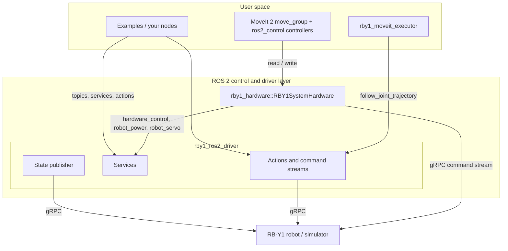

# Overview

[Overview](01_overview.md) · [Driver](02_driver.md) · [Examples](03_examples.md) · [Description](04_description.md) · [Hardware Interface](05_hardware_interface.md) · [MoveIt](06_moveit.md) · [Tools](07_tools.md)

`rby1_ros2` is the ROS 2 driver of the Rainbow Robotics RB-Y1. It wraps the RB-Y1 C++ SDK in a ROS 2 node — state
monitoring and every control mode (joint position, Cartesian position, impedance, gravity compensation, command
streams and trajectories) through topics, services and actions — and adds a `ros2_control` hardware plugin, MoveIt 2
configurations and planners, the robot description, examples and tools.

- **ROS 2**: Humble on Ubuntu 22.04 (recommended), Jazzy on Ubuntu 24.04
- **SDK**: rby1-sdk `0.10.x` and later, built from source
- **Robots**: RB-Y1 model A (v1.0–1.2) and model M (v1.0–1.3), and the simulator (`rainbowroboticsofficial/rby1-sim`)
- Questions, problems or requests: **rby.support@rainbow-robotics.com**

## Architecture


Two paths lead to the robot, and they share one connection rule: the robot takes commands from one owner at a time.

1. **The driver (`rby1_ros2_driver`)**. A C++ node connected to the robot or the simulator over gRPC. It publishes
   the robot's state at 100 Hz and takes commands as services (power, servo, control manager, gravity
   compensation, stream channels) and actions (`robot_joint`, `robot_cartesian`, `follow_joint_trajectory`,
   `stream_joint`, `stream_cartesian`), plus `cmd_vel` for the base. Everything in this repository that moves the
   robot goes through it, apart from the hardware plugin: the examples, the MoveIt planner
   (`rby1_moveit_executor`), the tools. Details: [Driver](02_driver.md).
2. **The `ros2_control` hardware plugin (`rby1_hardware/RBY1SystemHardware`)**. Loaded by a `ros2_control`
   controller manager — under MoveIt (`rby1_moveit_*` `demo.launch.py`) or alone (`rby1_hardware.launch.py`). It
   streams joint positions to the robot over its own gRPC connection, and asks the running driver for power, servos
   and the **control right** (`/rby1/hardware_control`): while it holds the right, the driver refuses its own command
   sources; Ctrl+C on the controller manager returns it. Details: [Hardware Interface](05_hardware_interface.md).



Everything of the robot is under the driver's namespace, `/rby1/` by default (`/rby1/robot_joint`,
`/rby1/joint_overall_states`). What belongs to one part is `/rby1/<part>/<what>` (`/rby1/right_arm/target_pose`);
what a tool offers is `/rby1/<tool>/<what>`; camera images are not the robot's and stay under `/camera/`.

## Packages

| Package | What it is | Manual |
|---------|------------|--------|
| `rby1_driver` | The driver node (C++): `rby1_ros2_driver`, its launch file and `config/driver_parameters.yaml` | [Driver](02_driver.md) |
| `rby1_msgs` | The messages, services and actions of the driver | [Driver — Messages](02_driver.md#messages) |
| `rby1_examples` | Python examples 01–16 of every feature of the driver | [Examples](03_examples.md) |
| `rby1_description` | URDFs and meshes of every model and version, a state publisher launch for RViz | [Description](04_description.md) |
| `rby1_hardware` | The `ros2_control` hardware plugin and a launch file that runs `ros2_control` without MoveIt | [Hardware Interface](05_hardware_interface.md) |
| `rby1_moveit_{a,m}_{1_0,…}` | MoveIt 2 configuration per model and version (SRDF, kinematics, joint limits, controllers) with `demo.launch.py` | [MoveIt — demo.launch.py](06_moveit.md#demolaunchpy) |
| `rby1_moveit_executor` | A planner that takes tool pose targets, plans with MoveIt (OMPL) around the planning scene and runs the result through the driver | [MoveIt — Executor](06_moveit.md#executor-rby1_moveit_executor) |
| `rby1_moveit_objects` | Objects in the planning scene: obstacles (`scene`), modules on the robot (`objects.launch.py`), an obstacle kept where a topic says | [MoveIt — Objects](06_moveit.md#objects-rby1_moveit_objects), [Scene](06_moveit.md#scene) |
| `rby1_tools` | Camera publishers and their mount, the gripper (model, planning-scene parts, virtual and real controller) | [Tools](07_tools.md) |
| `rby1_bringup` | One launch file that starts the driver and whatever runs with it, by flags | [Bringup](#bringup-rby1_bringup) |
| `rby1_navigation` | Not finished; not described here | — |

## Install and build

In a plain environment, not a conda or miniforge one (their Python and CMake get in the way).

1. **ROS 2**: Humble (22.04) or Jazzy (24.04) as its installation guide says. Below `humble` stands for either.
2. **The RB-Y1 SDK**, built from source as its README says: <https://github.com/RainbowRobotics/rby1-sdk>.
   `rby1_driver`, `rby1_hardware` and `rby1_tools`' gripper driver find it through `RBY1_SDK_PATH`, the SDK's source
   tree with its build in `build/` (headers `include/rby1-sdk`, library `build/src`). The driver and the hardware
   plugin refuse to configure without it, with a message; the gripper driver is left out of the build.
3. **The simulator** (optional): <https://hub.docker.com/r/rainbowroboticsofficial/rby1-sim>. Its address is
   `127.0.0.1:50051`; the tag picks model and version (`0.10.6-a_v1.2`, `0.10.6-m_v1.3`). Model A goes up to v1.2,
   model M to v1.3.

```bash
mkdir -p rby1_ros2_ws/src && cd rby1_ros2_ws/src
git clone https://github.com/RainbowRobotics/rby1-ros2.git
cd ..
source /opt/ros/humble/setup.bash
sudo rosdep init && rosdep update                # init once per PC; "already initialized" is fine
rosdep install --from-paths src --ignore-src -y  # MoveIt 2, ros2_control and its controllers, cv_bridge, librealsense2, ...
export RBY1_SDK_PATH=$HOME/sdk/rby1-sdk          # and in ~/.bashrc
colcon build --symlink-install
source install/setup.bash
```

`rosdep` reads every `package.xml` and installs what they declare as apt packages, so no MoveIt source build is needed;
the binaries also run on the robot's UPC. For an Intel RealSense the camera's udev rules have to be installed by hand
([Tools — Camera](07_tools.md#camera)).

`~/.bashrc` then carries `export RBY1_SDK_PATH=…` and `source /opt/ros/humble/setup.bash`. A `ROS_DOMAIN_ID` is
optional; everything that talks to the driver — examples, MoveIt, tools on another PC or in a container — needs the
same one (`ros2 node list` shows `/rby1/rby1_ros2_driver` from any terminal of the domain).

Humble and Jazzy both build from the same source. What was adjusted for Jazzy (2026-10-30, from a report of a Jazzy
build): `cv_bridge.hpp` is used where it exists (`cv_bridge.h` on Humble); the MoveIt packages declare
`joint_state_broadcaster` and `joint_trajectory_controller` and no longer `warehouse_ros_mongo` (not in apt);
`joint_limits.yaml` writes the acceleration limit MoveIt Humble used by default (1.0 rad/s²), which MoveIt Jazzy
refuses to plan without; the `demo.launch.py` have no `chrt` prefix (`ros2_control_node` sets its own real-time
priority where the user may, [Hardware Interface](05_hardware_interface.md#real-time-scheduling)).

## Run

```bash
ros2 launch rby1_driver rby1_ros2_driver.launch.py                                   # config/driver_parameters.yaml
ros2 launch rby1_driver rby1_ros2_driver.launch.py robot_ip:=192.168.30.1:50051 model:=a   # another robot, without editing it
```

Then, each in its own terminal: an example (`ros2 run rby1_examples 06_zero_pose`), the MoveIt planner, the tools —
or `rby1_bringup`, which starts the driver and the rest together. **Test in the simulator first.**

## Bringup (`rby1_bringup`)

One launch file starts the driver and the parts you switch on. The switches are `True`/`False` flags at the top of
`rby1_bringup/launch/bringup.launch.py`, one line each with a comment; **what each part starts with** is in
`rby1_bringup/config/bringup.yaml`, one section per part with the arguments of that part's own launch file (an empty
value means that launch file's default). Each part in the launch file is its own launch file included with its
arguments written out, so a block can be copied or changed as it is.

```bash
ros2 launch rby1_bringup bringup.launch.py
```

| Flag | Starts | Its section in `bringup.yaml` | Manual |
|---|---|---|---|
| `DRIVER` (on) | the driver | `driver`: `params_file`, `namespace`, `robot_ip`, `model` | [Driver](02_driver.md) |
| `MOVEIT_EXECUTOR` | the MoveIt planner that moves the arms through the driver | `moveit_executor`: `rviz`, `velocity_scaling`, `minimum_time`, `impedance`, `ready_pose`, `version` | [Executor](06_moveit.md#executor-rby1_moveit_executor) |
| `MOVEIT_DEMO` | MoveIt with `ros2_control` (not together with the planner: one `move_group` per domain) | `moveit_demo`: `package`, `use_fake_hardware` | [demo.launch.py](06_moveit.md#demolaunchpy) |
| `ROS2_CONTROL` | `ros2_control` with the hardware plugin, without MoveIt (not together with `MOVEIT_DEMO`) | `ros2_control`: `use_fake_hardware` (which robot: the top of `rby1_hardware`'s launch file) | [Hardware Interface](05_hardware_interface.md#using-it-without-moveit) |
| `SCENE` | obstacles loaded into the planning scene | `scene`: `config` | [Scene](06_moveit.md#scene) |
| `OBJECTS` | modules on the robot or fixtures in the planning scene | `objects`: `config` | [Objects](06_moveit.md#objects-rby1_moveit_objects) |
| `CAMERA` | the camera publisher | `camera`: `camera`, `config`, `source`, `intrinsics`, `mount` | [Camera](07_tools.md#camera) |
| `GRIPPER` | the gripper on the hands: its model on TF, its parts in the planning scene, a virtual or the real controller | `gripper`: `model`, `scene`, `controller`, `hands`, `mount`, `config` | [Gripper](07_tools.md#gripper) |

Before anything starts the launch checks the combination and stops with one line when it is wrong — a missing
section, a bad model or address, planner and demo together, a demo package that is not built or is for the other
model, an RB-Y1 v1.3 (`moveit_executor.version: 1.3`) with the gripper's model or scene switched on (its robot model
carries the gripper), nothing switched on at all — and prints a warning when something will wait: the scene or the
objects without a `move_group` started here, a v1.3 without `GRIPPER` (its finger joints get their states from the
gripper controller). The planner is included 3 s after the driver (it looks the driver up while it starts), the
scene, the objects and a gripper with its scene on once `move_group` is up.

## Troubleshooting

**The build stops at `RBY1_SDK_PATH`.** It is not set, or does not point at a built SDK (`include/rby1-sdk/robot.h`
and `build/src` must exist there). Set it in `~/.bashrc` and open a new terminal.

**`rosdep` cannot locate a definition.** A package of the workspace declares something apt does not have. As of
2026-10-30 none does on Humble or Jazzy; `rosdep install … --skip-keys <name>` gets past one that appears.

**A command toward the robot is refused.** The answer says why. The common ones: the control manager is not enabled
(`control_manager_command 1`), a stream channel the command needs is closed (open it with `stream_control`, or
close every channel), the hardware plugin holds the control right (stop the controller manager, or
`/rby1/hardware_control state: false`), a trajectory's first point is out of reach in its time
([Driver — Command streams](02_driver.md#command-streams)).

**Commands are refused after a streaming node died.** The channels it opened stay open, and other command sources
are refused until they are closed: `ros2 service call /rby1/stream_control rby1_msgs/srv/StateOnOff "{state: false}"`.
Left alone, the driver closes only a channel that got no command within 60 s of being opened.

**The driver stops answering after streams were opened and closed many times.** Seen once (2026-10-06) against a
simulator that had been up for hours and had had drivers killed with streams open; one capture showed the SDK's
`SendCommand` waiting forever. Stop the driver (`kill -9` if Ctrl+C does nothing) and start it again; a driver killed
with a stream open leaves its last command with the robot — clear it once with `/rby1/cancel_control`. If it comes
back, restart the simulator. Do not kill a driver with streams open when Ctrl+C will do.

**A freshly started simulator refuses to enable.** It may come up in a fault, or with a joint outside its limit. In
that order: `robot_power` and `robot_servo` with `parameters: all`, then `control_manager_command 1`; a joint over its
limit needs `control_manager_command 4` (unlimited) once, then a move back inside (`06_zero_pose`).

**`Collision detected!` right after start.** The robot stands in a pose the model counts as a collision (the
simulator's initial pose can). The driver warns and goes on; `robot_state.collision` is set. Command a clear pose.
`collision_threshold` ([Driver — Parameters](02_driver.md#parameters)) is the distance it warns at.

**`Ignoring unexpected goal/result response` in a Python client.** `time.sleep()` kept the executor from spinning and
DDS answers piled up. Spin while waiting (`rclpy.spin_once` in a loop), as `13_stream_command` does.

**`move_group` dies with a segmentation fault on Ctrl+C.** MoveIt 2.5.9 (Humble) unloads its controller plugin
before the node that plugin built; the executor's launch preloads the library so it stays loaded
([Executor](06_moveit.md#executor-rby1_moveit_executor)). The `demo.launch.py` do not.

**MoveIt refuses every target with error 99999.** Something attached to the robot overlaps a link that is not in its
`touch_links` — a tool through the gripper, the gripper on a v1.3 whose URDF has it already
([Objects](06_moveit.md#objects-rby1_moveit_objects)).

**On Jazzy, `No acceleration limit was defined for joint …`.** A `joint_limits.yaml` older than 2026-10-30; the
current ones define it.
