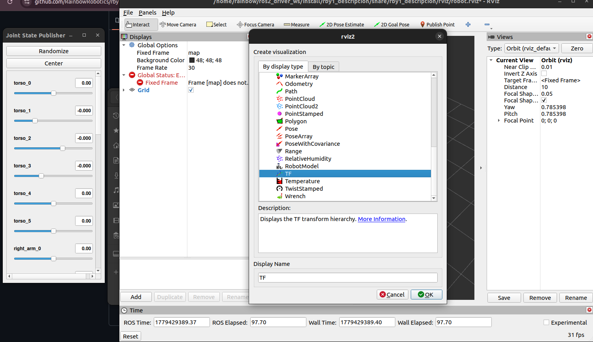
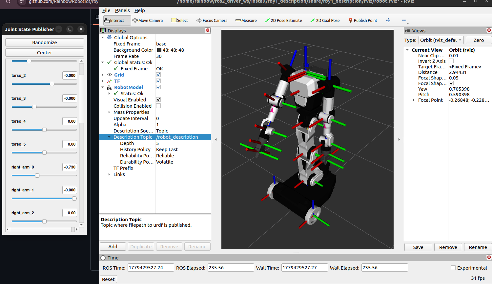

# Description (`rby1_description`)

[Overview](01_overview.md) · [Driver](02_driver.md) · [Examples](03_examples.md) · [Description](04_description.md) · [Hardware Interface](05_hardware_interface.md) · [MoveIt](06_moveit.md) · [Tools](07_tools.md) · [UPC Topic Bridge](08_upc_topic_bridge.md)

The robot models: a URDF per model and version under `urdf/rby1<model>/model_v<version>.urdf`, their meshes under
`meshes/rby1<model>/`, and a launch file that shows one in RViz with a joint slider. The MoveIt configuration
packages and the gripper model of `rby1_tools` build on these files; use them for anything of your own about the robot.

| Model | Versions | Base |
|-------|----------|------|
| `rby1a` (RB-Y1 A) | `1_0`, `1_1`, `1_2` | differential drive: `base` is 0.228 m behind the wheel axle |
| `rby1m` (RB-Y1 M) | `1_0`, `1_1`, `1_2`, `1_3` | mecanum: `base` is on the axle |

- **Frames.** The root link is `base`, on the floor (the SDK's wheel radius equals the axle height: M 0.076 m, A
  0.1 m). The arms end at the tool frames `ee_right` / `ee_left`, 0.125 m beyond `link_right_arm_6` / `link_left_arm_6`
  along the forearm; `link_torso_5` carries the head (`link_head_0..2`) and the arms. The driver ties the model to its
  odometry: `odom → base_footprint` every cycle and the static `base_footprint → base` of the model once at start
  ([Driver](02_driver.md)).
- **Gripper.** Up to v1.2 the URDFs **end at the tool frames**: the gripper is not in the model. For TF and RViz it
  comes from `rby1_tools`' gripper model (mounted under `ee_<hand>` by a second `robot_state_publisher`), for MoveIt
  from the gripper's parts in the planning scene — both from `gripper.launch.py` ([Tools — Gripper](07_tools.md#gripper)).
  **v1.3 carries its gripper in the URDF**: links `gripper_right` / `gripper_left` and prismatic finger joints
  `gripper_finger_<r|l>1_joint` (0..0.05 m) and `_2_joint` (−0.05..0). Those joints are not driven by the robot, so
  their joint states come from the gripper controller (`joint_states_topic:=/joint_states`), or TF and MoveIt miss
  them. The gripper meshes (`EE_BODY.dae`, `EE_FINGER.dae`, `EE_GR_TF.dae`) stay in `meshes/`.
- **Joints**, as the SDK names them: `torso_0..5`, `right_arm_0..6`, `left_arm_0..6`, `head_0..1`, and the wheels
  (`right_wheel`, `left_wheel` on A; four on M). The driver's `joint_overall_states` carries them all.

```bash
ros2 launch rby1_description rby1_state_publisher.launch.py model:=a version:=1_1
ros2 launch rby1_description rby1_state_publisher.launch.py model:=m version:=1_3
```

| Launch argument | Default | Meaning |
|---|---|---|
| `model` | `a` | `a` or `m` |
| `version` | `1_0` | `1_0`, `1_1`, `1_2` (`1_3` on M), with an underscore |
| `use_sim_time` | `false` | |

It starts `robot_state_publisher` with the URDF, `joint_state_publisher_gui` (sliders for every joint) and RViz. In
RViz add the `TF` and `RobotModel` displays, set the fixed frame to `base` and the RobotModel's topic to
`/robot_description`:




With the driver running instead of the slider, the same `robot_state_publisher` takes `/rby1/joint_overall_states`
(remap `joint_states` to it, or use the relay of `rby1_moveit_executor`) and the model follows the robot.

## How the MoveIt packages use it

Each `rby1_moveit_<model>_<version>` has `config/RBY1_<M|A>_v<version>.urdf.xacro`, which includes the URDF of this
package and adds the `<ros2_control>` block (`*.ros2_control.xacro`: the hardware plugin or the mock, one position
command and state interface per joint; v1.3 also the finger joints, with a velocity state), the SRDF (planning
groups `right_arm`, `left_arm`, `both_arms`, `torso`, `head`, `body`; v1.3 also the grippers), `joint_limits.yaml`
(velocity limits from the URDF, and since 2026-10-30 an acceleration limit of 1.0 rad/s² per joint — MoveIt Humble's
default when none is given, which MoveIt Jazzy refuses to plan without; the driver and the robot apply their own
limits on top), `kinematics.yaml`, `initial_positions.yaml`, `ros2_controllers.yaml` and `moveit_controllers.yaml`
([MoveIt](06_moveit.md)). A change to a URDF is a change to every one of them: rebuild and check the MoveIt package of
that model.
