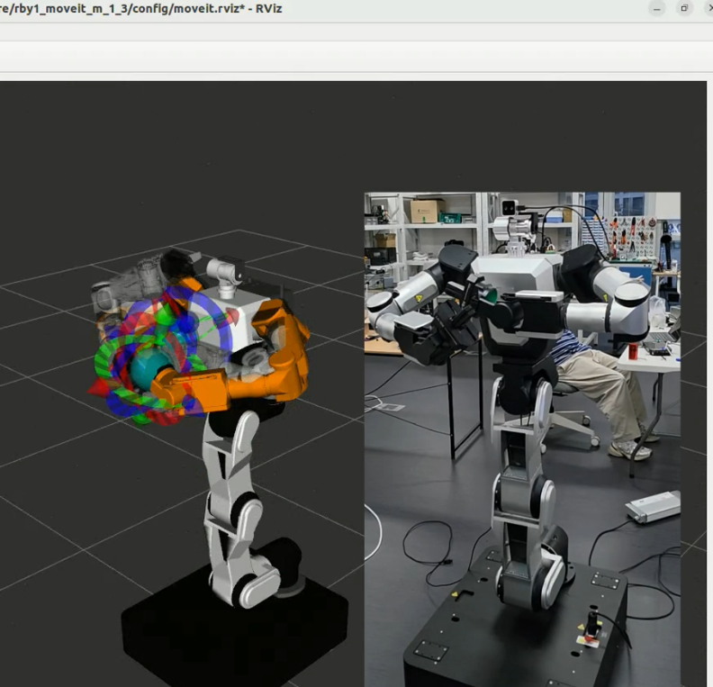

# MoveIt (`rby1_moveit_*`, `rby1_moveit_executor`, `rby1_moveit_objects`)

[Overview](01_overview.md) · [Driver](02_driver.md) · [Examples](03_examples.md) · [Description](04_description.md) · [Hardware Interface](05_hardware_interface.md) · [MoveIt](06_moveit.md) · [Tools](07_tools.md) · [UPC Topic Bridge](08_upc_topic_bridge.md)

Two ways to plan with MoveIt 2 on the RB-Y1, and the planning scene they share:

| | `demo.launch.py` | `rby1_moveit_executor` |
|---|---|---|
| Starts | `move_group`, RViz with the MotionPlanning display, `ros2_control` with the [hardware plugin](05_hardware_interface.md) | `move_group`, RViz, the executor node, a joint state relay |
| Moves the robot through | `ros2_control` controllers (the plugin holds the control right) | the driver's `follow_joint_trajectory` |
| Driven by | the RViz panel, MoveIt's own interfaces | tool pose targets on a topic ([target interface](#target-interface)) |
| Package | one per model and version | one; picks the configuration from the driver's model and version |

Only one `move_group` per ROS domain: the two do not run together. The planning scene — obstacles
([Scene](#scene)) and modules on the robot ([Objects](#objects-rby1_moveit_objects)) — works with either.



## demo.launch.py

| Package | Robot |
|---------|-------|
| `rby1_moveit_a_1_0`, `rby1_moveit_a_1_1`, `rby1_moveit_a_1_2` | RB-Y1 A v1.0, v1.1, v1.2 |
| `rby1_moveit_m_1_0`, `rby1_moveit_m_1_1`, `rby1_moveit_m_1_2`, `rby1_moveit_m_1_3` | RB-Y1 M v1.0 … v1.3 (v1.3 with the gripper in its model) |

Each holds the complete MoveIt 2 configuration of that robot (the xacro with the `<ros2_control>` block, SRDF,
kinematics, `joint_limits.yaml`, `ros2_controllers.yaml`, `moveit_controllers.yaml`; [Description — How the MoveIt
packages use it](04_description.md#how-the-moveit-packages-use-it)). With real hardware the **driver must be running
first**: the plugin claims the control right from it. **Match the package to the robot's version.**

```bash
ros2 launch rby1_driver rby1_ros2_driver.launch.py                               # terminal 1
ros2 launch rby1_moveit_m_1_2 demo.launch.py                                     # terminal 2: real hardware or the simulator
ros2 launch rby1_moveit_m_1_2 demo.launch.py robot_ip:=192.168.30.1:50051
ros2 launch rby1_moveit_m_1_2 demo.launch.py use_fake_hardware:=true             # mock hardware: no robot, no driver
```

| Argument | Default | Meaning |
|----------|---------|---------|
| `use_fake_hardware` | `false` | `true`: `mock_components/GenericSystem`; `false`: `RBY1SystemHardware` |
| `robot_ip` | `127.0.0.1:50051` | The robot's address and gRPC port |
| `model` | `m` or `a`, the package's | Handed to the plugin |
| `driver_namespace` | `rby1` | Namespace of the driver |

The controllers it spawns, and how they share joints, are in [Hardware Interface](05_hardware_interface.md#how-it-is-built).
How the URDF reaches the controller manager differs by distro: on Humble `demo.launch.py` hands it over as a
parameter; on Jazzy the controller manager reads the `/robot_description` topic of the `robot_state_publisher` that
the package's `launch/rsp.launch.py` starts. That launch therefore renders the xacro with the same arguments
(`use_fake_hardware`, `robot_ip`, `model`, `driver_namespace`) as `demo.launch.py` — before 2026-11-02 it used the
xacro defaults, and on Jazzy the demo always ran on mock hardware whatever was asked for (plan and execute
succeeded, the robot did not move; `ros2 control list_hardware_components -v` showed `mock_components/GenericSystem`).
In RViz: `You can start planning now` in the log, then plan and execute from the MotionPlanning panel. The launch
ends when `ros2_control_node` or `move_group` dies. On a v1.3 the finger joints need the gripper controller's joint
states ([Tools — Gripper](07_tools.md#gripper)). In `rby1_bringup` this is `MOVEIT_DEMO`.

## Executor (`rby1_moveit_executor`)

A planner that takes tool pose targets, plans with MoveIt (OMPL) around the planning scene and runs the trajectory
through the driver's `follow_joint_trajectory` — no `ros2_control`.

```bash
ros2 launch rby1_moveit_executor moveit_executor.launch.py              # with RViz; rviz:=false without
```

- **Robot**: model and version are read from the driver and pick `rby1_moveit_<model>_<version>` (`model:=m
  version:=1.2` names it; write `version:=1.3` for a v1.3, whose gripper is in the model).
- **Start**: it checks for an emergency stop and faults, switches power and servos on, and takes what is straight to
  the **ready pose** in one move — **the robot moves, on both sides** — then answers `READY`. The ready pose is
  `config/ready_pose.yaml` (`ready.right_arm`, `.left_arm`, `.torso`; another file with `ready_pose:=/path`): each arm
  with its elbow bent 90° (`[0, ∓0.5, 0, -1.57, 0, 0, 0]`), the torso with its knee bent about 57° and the chest level
  (`[0, 0.5, -1.0, 0.5, 0, 0]`). An arm counts as straight with its elbow within 0.3 rad of 0, the torso with its knee
  under half its ready angle; a part already bent is left as it is; `ready_if_straight:=false` skips it.
- **Both arms**: it listens on both arms' topics and answers each on its own status topic. A target for one arm is
  planned in that arm's group, the other stays; targets for both (within 0.1 s of each other) are planned as one move
  in `both_arms`. A target that arrives during a move is kept (the latest per arm) and planned when the move ends. A
  target the arm is already at (joints within 0.001 rad) is answered `DONE` without a move.
- **Obstacles**: the planning scene is planned around when a target arrives; nothing is checked while the arm moves.
  OMPL's collision checking step is set fine enough for a 6 cm box (`longest_valid_segment_fraction` 0.002 for the
  arms, 0.0014 for `both_arms`), and a path MoveIt's own check refuses is planned again, up to three times.
- **Arm shape**: for each target it asks MoveIt's IK from the arm's posture (and, when that fails or turns a joint
  more than 1 rad, from 8 random postures), takes the solution the arm turns least to reach and plans to those joints,
  so the planner cannot end in a far shape (`joint goal: the arm turns at most … rad`). When IK finds nothing it plans
  to the pose.
- **Move time**: MoveIt's timing scaled by `velocity_scaling` (0.5), at least `minimum_time` (2 s), or exactly
  `duration` when set (`ros2 param set /rby1_target_executor duration 3.0`).
- **Joint impedance**: `impedance:=true` (or the `impedance.enabled` parameter) follows trajectories in joint
  impedance — the arms with a target in that move; `impedance.stiffness` (500 N·m/rad), `impedance.damping_ratio`
  (1.0), `impedance.torque_limit` (50 N·m) go to the driver's `set_trajectory_impedance` before the move.
- **Streams**: it opens `right_arm, left_arm` for a move and closes them afterwards — only what it opened.
- **Shutdown**: MoveIt 2.5.9 (Humble) unloads its controller plugin before the node that plugin built, so
  `move_group` died on Ctrl+C with a segmentation fault; the launch preloads that library (`LD_PRELOAD`) so it stays
  loaded, and `move_group` exits cleanly. The launch refuses to start next to another `move_group`.

| Launch argument | Default | Meaning |
|-----------------|---------|---------|
| `rviz` | `true` | RViz with the MotionPlanning display |
| `velocity_scaling` | `0.5` | Share of the joint velocity limits MoveIt times the path with |
| `minimum_time` | `2.0` | Shortest move (s) |
| `impedance` | `false` | Follow trajectories in joint impedance |
| `ready_pose` | `config/ready_pose.yaml` | The ready pose file |
| `model`, `version` | from the driver | Robot kind and version |
| `driver_namespace` | `rby1` | Namespace of the driver |

Other node parameters (`ros2 param set /rby1_target_executor …`): `pipeline` (`ompl`), `planner_id`,
`planning_attempts` (5), `planning_time` (5.0 s), `position_tolerance` (0.001 m) and `orientation_tolerance`
(0.01 rad) for a target planned as a pose, `acceleration_scaling` (0.5), `step` (0.05 s between trajectory points),
`hold` (0.5 s at the end), `endpoint_tolerance` (0.03 rad), `ready_if_straight`, `straight_elbow` (0.3 rad),
`ready_time` (4.0 s), `enable_robot` (true). Source: `src/executor.cpp`, `src/trajectory.cpp`, `src/robot.cpp`,
`src/joint_state_relay.cpp`; tests with `colcon test --packages-select rby1_moveit_executor`. In `rby1_bringup` this is
`MOVEIT_EXECUTOR`.

### Target interface

| Name | Type | Content |
|------|------|---------|
| `/rby1/<arm>/target_pose` | `std_msgs/Float64MultiArray` | 16 values: the row-major 4×4 pose of the tool frame (`ee_right`, `ee_left`) in `base`. `<arm>` is `right_arm` or `left_arm` |
| `/rby1/<arm>/target_status` | `std_msgs/String` | `READY`, `PLANNING`, `EXECUTING planner_time=… duration=… steps=… peak_velocity=…`, `DONE`, `FAILED: <reason and what to do>` |
| `/rby1_target_executor` | node | `ros2 param set /rby1_target_executor <name> <value>` while it runs |

Example `16_target_shuttle_publisher`, the marker-to-target node of the RB-Y1 Isaac ROS repository
(`rby1_apriltag`) and the tools here only use this interface, so they work with any executor that implements it: this
one, example `15_cartesian_target_move` (no planner, no collision check; [Examples](03_examples.md#15_cartesian_target_move))
and the cuMotion executor of the Isaac ROS repository, which adds `AVOIDING`, `WAITING`, `RESUMING`, `REPLACED` and a
tracking mode (`/rby1/target_executor/set_tracking`, `std_srvs/SetBool`). Only one executor may listen on an arm's
`target_pose` at a time. Other names of the robot's tools: `/rby1/marker_<id>/pose` and `/rby1/marker/pose`
(`geometry_msgs/PoseStamped`, the marker detector), `/rby1/scene/object_point` (`geometry_msgs/PointStamped`,
[`object_at_point`](#objects-rby1_moveit_objects)).

Names before October 2026, for programs written against them: `/rby1/target_pose` and `/rby1/target_status` (now one
pair per arm), `/rby1_target_executor/set_tracking` (now `/rby1/target_executor/set_tracking`),
`/target_marker_<id>/pose` (now `/rby1/marker_<id>/pose`), package `rby1_moveit_scene` (merged into
`rby1_moveit_objects`), example `16_target_shuttle` (now `16_target_shuttle_publisher`).

## Objects (`rby1_moveit_objects`)

Everything that puts objects into the planning scene of a `move_group` on the same ROS domain:

| Tool | Started with | What it does |
|------|--------------|--------------|
| `publish_objects` | `objects.launch.py` | Modules on robot links and fixtures in the world, from a YAML file, kept in the scene while it runs |
| `scene` | `ros2 run rby1_moveit_objects scene …`, `scene.launch.py` | Obstacles: add, move, remove, list, load a file ([Scene](#scene)) |
| `object_at_point` | `point_object.launch.py` | One obstacle put where `/rby1/scene/object_point` says, or where a pose such as a marker's is ([Scene](#scene)) |

**Modules on the robot** — grippers, sensors, tools — are given in a YAML file: the frame (a robot link such as
`ee_right`, or `base`), the pose, a mesh or a box, sphere or cylinder. They show in RViz and are planned with while
the node runs; it needs a running `move_group`, puts them back within 2 s when `move_group` restarts, and takes them
away at Ctrl+C.

```bash
ros2 launch rby1_moveit_objects objects.launch.py                                        # config/objects.yaml: a camera on the head, a rod in the right hand, a workbench
ros2 launch rby1_moveit_objects objects.launch.py config:=/path/to/my_objects.yaml
ros2 launch rby1_moveit_objects objects.launch.py config:=rby1_tools/model/rby1_gripper/gripper.yaml   # <package>/<path>: the gripper
```

```yaml
objects:
  - name: head_camera          # unique name in the scene
    frame: link_head_2         # a robot link (ee_right, ee_left, link_head_2, link_torso_5 ...) or base
    attach: true               # true: fixed to that link, moves with it (default) / false: placed in the world where the frame is now
    xyz: [0.06, 0.0, 0.03]     # pose in `frame` (m), default 0
    rpy: [0.0, 0.0, 0.0]       # (rad), default 0
    type: mesh                 # box (size) / sphere (radius) / cylinder (radius, height; along z) / mesh
    mesh: meshes/camera_box.stl   # relative to this YAML, absolute, file://..., or package://<package>/...
    scale: [1.0, 1.0, 1.0]
    touch_links: [link_head_2] # (attached) robot links -- or other modules -- it may touch without that counting as a collision; default: its own link
    # follows: {topic: /rby1/right_gripper/state, joint: gripper_finger_r1, axis: [1.0, 0.0, 0.0], initial: 0.05}
    #                          # (attached) moves with that joint of a sensor_msgs/JointState topic: xyz is the pose at
    #                          # position 0, shifted by axis * position; `initial` until the topic gives one
```

- `config` is a path, a file name of this package's `config/`, or `<package>/<path>` in another package's share.
- Meshes: STL, DAE, OBJ and whatever else assimp reads.
- An object that overlaps robot links — a tool through the gripper — needs those links in `touch_links`; without them
  MoveIt sees the present pose as a collision and refuses every target (`FAILURE (MoveIt error 99999)`).
- An attached object is part of the arm for MoveIt (OMPL): checked against the scene and the robot.
- **The gripper** is such a file: `rby1_tools/model/rby1_gripper/gripper.yaml`, the body and two fingers per hand on
  `ee_right` / `ee_left` with the gripper's own meshes, each finger following its joint on
  `/rby1/<hand>_gripper/state`. `rby1_tools`' `gripper.launch.py scene:=true` loads it, with the gripper mount applied
  ([Tools — Gripper](07_tools.md#gripper)). The robot model up to v1.2 has no gripper, so **without it MoveIt plans as
  if the hand ended at the tool frame**; on a v1.3, whose URDF has the gripper, the node refuses the file (it would put
  a second gripper on the hands).

The package installs as a library too (`find_package(rby1_moveit_objects)`,
`rby1_moveit_objects::rby1_moveit_objects`): `object_spec` (object definition to `CollisionObject`, files of
obstacles), `scene` (the planning scene client), `command` (the `scene` command line), `modules` (module files, mesh
reading, add and remove diffs), `point_object`. Tests: `colcon test --packages-select rby1_moveit_objects`.

## Scene

**Obstacles: the `scene` command.** Poses are in `base`, the root link of every RB-Y1. Objects go in through
`/apply_planning_scene`, whose answer comes after `move_group` applied the change: when a command succeeds, the object
is in the scene.

```bash
ros2 run rby1_moveit_objects scene add box table --xyz 0.7 0.0 0.35 --size 0.6 1.2 0.7
ros2 run rby1_moveit_objects scene add sphere ball --xyz 0.45 0.35 1.0 --radius 0.06
ros2 run rby1_moveit_objects scene add cylinder post --xyz 0.5 -0.5 0.9 --radius 0.04 --height 0.6
ros2 run rby1_moveit_objects scene move ball --velocity 0 -0.1 0 --time 3    # slide at 0.1 m/s for 3 s, then leave it there
ros2 run rby1_moveit_objects scene list
ros2 run rby1_moveit_objects scene remove ball
ros2 run rby1_moveit_objects scene clear
ros2 launch rby1_moveit_objects scene.launch.py                              # loads config/example_scene.yaml (a table, a post, a ball) and ends; they stay
ros2 launch rby1_moveit_objects scene.launch.py config:=/path/to/my_scene.yaml
```

| Option | Meaning |
|--------|---------|
| `--xyz X Y Z` | Centre (m); `--rpy R P Y` orientation (rad); `--frame` the pose's frame, default `base` |
| `--size SX SY SZ`, `--radius`, `--height` | Box, sphere and cylinder size (m) |
| `move --velocity VX VY VZ --time T --rate` | Slide an existing object (m/s, in its frame) for T s; it stays where it ends; updates per second, default 10 |

```yaml
objects:
  - name: table                # unique name in the scene
    type: box                  # box (size) / sphere (radius) / cylinder (radius, height; along z)
    xyz: [0.7, 0.0, 0.35]      # centre (m)
    size: [0.6, 1.2, 0.7]
    rpy: [0.0, 0.0, 0.0]       # (rad), default 0
    frame: base                # default base
```

One bad entry refuses the whole file. Obstacle files have no `attach`, `mesh` or `touch_links`: they are not the
files `objects.launch.py` takes. In `rby1_bringup` this is `SCENE`.

**An obstacle where a topic says: `object_at_point`.** Puts one obstacle at every point it receives on
`/rby1/scene/object_point` (`geometry_msgs/PointStamped`; an empty `frame_id` means `base`), replacing the one put
before, so it moves and there is never a second one. The object is the node's parameters, `config/point_object.yaml`:
`name` (`point_object`), `kind` (`box`/`sphere`/`cylinder`), `size`/`radius`/`height`, `offset` (added to the point;
half the height in z stands it on the point), `rpy` — every number with a decimal point. It does not take the object
away when it ends (`scene remove point_object`). With `pose_topic` it follows a `geometry_msgs/PoseStamped` instead —
a marker's `/rby1/marker_7/pose` — taking each pose's position to `base` with TF; `min_move` (0.01 m) ignores a pose
that moved the object less than that (a marker's pose shakes a little), `remove_after` (s; 0 never) takes the object
out when no pose came for that long. It needs the robot's TF and the camera's mount TF.

```bash
ros2 launch rby1_moveit_objects point_object.launch.py                       # config/point_object.yaml: a 6 cm box
ros2 topic pub --once /rby1/scene/object_point geometry_msgs/msg/PointStamped "{header: {frame_id: base}, point: {x: 0.5, y: -0.3, z: 1.0}}"
ros2 launch rby1_moveit_objects point_object.launch.py pose_topic:=/rby1/marker_7/pose
ros2 run rby1_moveit_objects scene remove point_object
```

### Step by step

In the simulator first. Each step is its own terminal with `source install/setup.bash`, the driver running.

1. **Start the planner.** It switches power and servos on and takes the robot to the ready pose — **it moves** — then
   `READY`. Optionally the gripper, so the planner knows the hands' size.
   ```bash
   ros2 launch rby1_moveit_executor moveit_executor.launch.py              # rviz:=false without RViz
   ros2 launch rby1_tools gripper.launch.py scene:=true                    # optional: the gripper on both hands, in the scene and on TF
   ```
2. **Move to a target.** Example 16 sends two targets in turn, 5 cm forward and up of the ready pose and back, every
   `period` (5 s) until Ctrl+C; the planner answers `PLANNING`, `EXECUTING …`, `DONE`. The left arm the same way,
   with its topics and points on its side ([Examples](03_examples.md#16_target_shuttle_publisher)).
   ```bash
   ros2 topic echo /rby1/right_arm/target_status std_msgs/msg/String
   ros2 run rby1_examples 16_target_shuttle_publisher
   ```
3. **Put obstacles in**: `scene.launch.py` for a prepared set, `scene add` for one, `point_object.launch.py` for one
   that follows a topic or a marker (above).
4. **Shuttle around an obstacle.** With a box where the hand passes between the two points, every leg is planned
   around it; remove it and the legs are straight again. A way around takes longer: `period:=8.0` or more.
   ```bash
   ros2 run rby1_examples 16_target_shuttle_publisher --ros-args -p period:=10.0 \
       -p "point_a:=[0.413,-0.367,1.034,-1.571,-1.071,1.571]" -p "point_b:=[0.413,-0.167,1.134,-1.571,-1.071,1.571]"
   ros2 run rby1_moveit_objects scene add box shuttle_box --xyz 0.515 -0.23 1.17 --size 0.06 0.06 0.06   # while the hand rests
   ros2 run rby1_moveit_objects scene remove shuttle_box
   ```
   An object that lands on the arm or right in front of the moving hand cannot be gone around; the planner then
   refuses targets until it is moved.
5. **Put modules on the robot**: `objects.launch.py` with your file (the shipped one has a camera on the head, a rod
   in the right hand, a workbench). The rod is kept clear of things too. Close and open the gripper with
   `/rby1/right_gripper/grasp` ([Tools — Gripper](07_tools.md#gripper)) and watch its fingers move in the scene.
6. **Use markers a camera sees.** The camera publisher ([Tools — Camera](07_tools.md#camera)) gives the images and
   the camera's place on the robot; a marker detector (the RB-Y1 Isaac ROS repository's `rby1_apriltag`) publishes
   `/rby1/marker_<id>/pose`. `point_object.launch.py pose_topic:=/rby1/marker_7/pose` turns a marker into an obstacle
   the planner goes around; `marker_target.launch.py` of that repository turns the point under a marker into targets.
