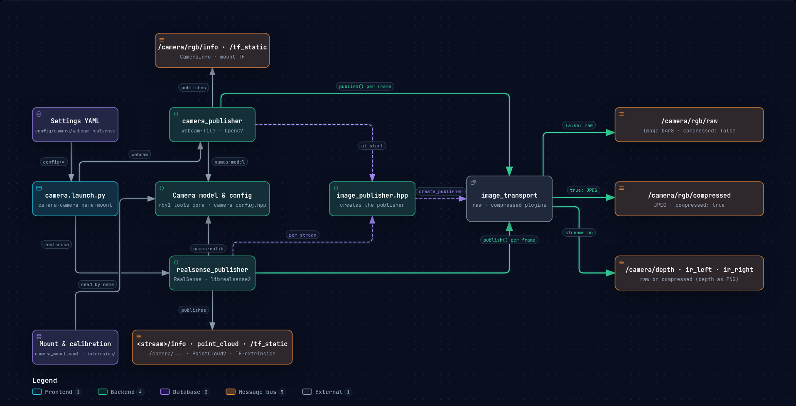
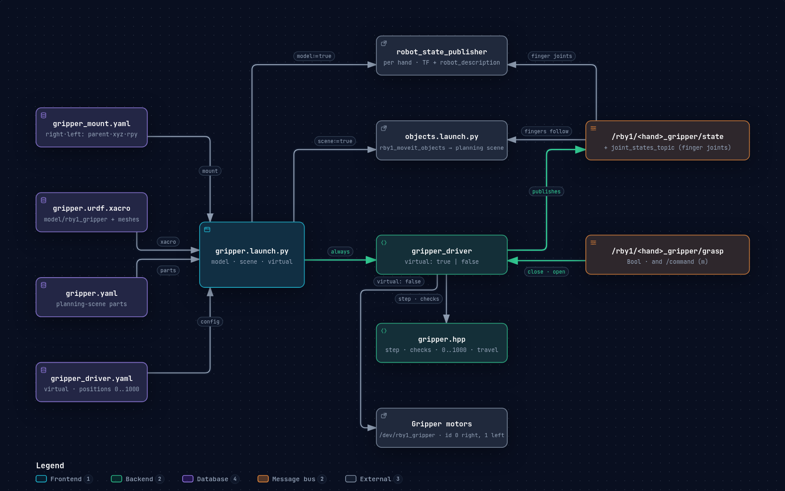
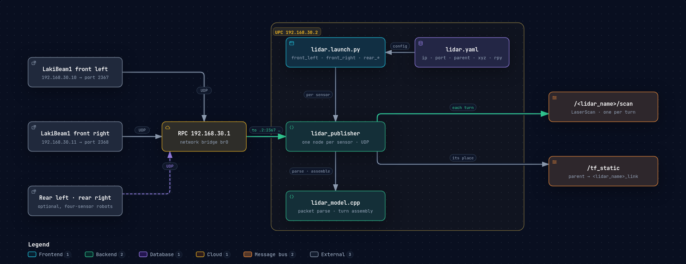

# Tools (`rby1_tools`)

[Overview](01_overview.md) · [Driver](02_driver.md) · [Examples](03_examples.md) · [Description](04_description.md) · [Hardware Interface](05_hardware_interface.md) · [MoveIt](06_moveit.md) · [Tools](07_tools.md)

What sits on the robot besides the robot: cameras and their place on it, the gripper, and the LiDARs.

## Camera

### Overview

Publishes a camera's images, its model and its place on the robot, so a marker detector or any other vision node —
on this machine or another — only needs topics. Two kinds: an Intel RealSense through librealsense directly (no
realsense-ros; only the streams switched on are opened), and a webcam through OpenCV (or an image or video file).



```bash
ros2 launch rby1_tools camera.launch.py                          # RealSense (config/camera/realsense.yaml)
ros2 launch rby1_tools camera.launch.py camera:=webcam           # webcam (config/camera/webcam.yaml)
ros2 launch rby1_tools camera.launch.py config:=/path/my.yaml    # other settings: another device, a file, a calibration
ros2 launch rby1_tools camera.launch.py camera_name:=desk mount:=none   # a second camera, on no link
ros2 launch rby1_tools camera.launch.py rviz:=true               # with RViz (config/camera/camera.rviz)
```

### Parameters

| Launch argument | Default | Meaning |
|-----------------|---------|---------|
| `camera` | `realsense` | `realsense` or `webcam` (a device, an image or a video file: `source` in the settings) |
| `camera_name` | `camera` | First part of the topics and frames: `/<camera_name>/…`, `<camera_name>_link`. Each camera of a robot gets its own |
| `config` | `config/camera/<camera>.yaml` | Settings file |
| `mount` | `head_default` | Where the camera sits: a name in `config/camera/camera_mount.yaml`; `none`: on no link |
| `rviz` | `false` | RViz with the image, the frames drawn over it, and the frames in 3D |

Everything else is set in the settings file; the launch file is written out flat (no helper functions), so its
`Node` blocks can be copied into another launch as they are.

`config/camera/realsense.yaml` (`realsense_publisher`):

| Setting | Default | Meaning |
|---------|---------|---------|
| `serial` | `""` | Which device: empty, the first one found; a serial, that one — or the node stops and lists the connected ones |
| `width`, `height`, `fps` | `1280`, `720`, `30` | The same for every stream switched on |
| `use_rgb`, `use_depth`, `use_ir`, `use_point_cloud` | `true`, `false`, `false`, `false` | What to publish (see Topics). A stream the device does not offer at this size and rate is warned about and left out; none left stops the node |
| `align_depth_to_color` | `false` | Depth (and the point cloud) aligned to the colour image's pixels and frame |
| `compressed` | `false` | `true`: every image on `…/compressed` only, no raw topics; JPEG, depth PNG. Not the point cloud |
| `auto_exposure`, `exposure` | `true`, `6000.0` µs | Colour exposure |
| `ir_auto_exposure`, `ir_exposure` | `true`, `8500.0` µs | Infrared and depth exposure (a D405 shares one sensor: the colour values apply) |
| `skip_frames` | `10` | Frames dropped at start while the exposure settles |
| `intrinsics_file` | `""` | Colour calibration in `config/camera/intrinsics/` (or an absolute path); empty: the factory calibration |

`config/camera/webcam.yaml` (`camera_publisher`):

| Setting | Default | Meaning |
|---------|---------|---------|
| `source` | `"0"` | Device number, `/dev/videoN`, or a file: an image (published over and over) or a video (looped) |
| `width`, `height`, `fps` | `1280`, `720`, `30.0` | Asked of the camera (the size it gives is used) |
| `auto_exposure`, `exposure` | `true`, `100.0` | Manual exposure in the driver's unit (V4L2: 100 µs) |
| `compressed` | `false` | `true`: the image as JPEG on `…/rgb/compressed` only, no raw topic |
| `intrinsics_file` | `""` | A calibration in `config/camera/intrinsics/` (or an absolute path); empty: none |
| `horizontal_fov` | `69.0` | Horizontal field of view (deg) of the pinhole model used without a calibration; distances are then approximate |

`config/camera/camera_mount.yaml`: one entry per place a camera goes — `<name>: {parent, xyz (m), rpy (rad)}`. Only
`head_default` is there now.

### Topics

Topics and frames, all published by the camera node itself (`<camera_name>` is `camera` unless set). These are all
of them: each image stream has its image on `raw` **or** `compressed` (the `compressed` setting), and its camera model
on `info`.

| Topic / frame | Type | When | Content |
|---------------|------|------|---------|
| `/<camera_name>/rgb/raw` | `sensor_msgs/Image` | `compressed: false` | Colour image, `bgr8` |
| `/<camera_name>/rgb/compressed` | `sensor_msgs/CompressedImage` | `compressed: true` | Colour image, JPEG |
| `/<camera_name>/rgb/info` | `sensor_msgs/CameraInfo` | always | Colour camera model |
| `/<camera_name>/depth/raw` / `…/depth/compressed` | `Image` / `CompressedImage` | RealSense, `use_depth` | Depth, `16UC1` in mm (compressed: PNG, lossless) |
| `/<camera_name>/depth/info` | `CameraInfo` | RealSense, `use_depth` | Depth camera model |
| `/<camera_name>/ir_left/raw` / `…/ir_left/compressed` | `Image` / `CompressedImage` | RealSense, `use_ir` | Left infrared, `mono8` (compressed: JPEG) |
| `/<camera_name>/ir_left/info` | `CameraInfo` | RealSense, `use_ir` | Left infrared camera model |
| `/<camera_name>/ir_right/raw` / `…/ir_right/compressed` | `Image` / `CompressedImage` | RealSense, `use_ir` | Right infrared, `mono8` (compressed: JPEG) |
| `/<camera_name>/ir_right/info` | `CameraInfo` | RealSense, `use_ir` | Right infrared camera model |
| `/<camera_name>/point_cloud` | `sensor_msgs/PointCloud2` | RealSense, `use_point_cloud` | x, y, z in m, one point per depth pixel (NaN without depth) |
| TF `<parent> → <camera_name>_link` | static | `mount` not `none` | Where the camera sits: the `mount` entry (`head_default`: 22 mm forward and 40 mm up of `link_head_2`) |
| TF `<camera_name>_link → <camera_name>_optical_frame` | static | always | Frame of the colour image (z forward, x right, y down) |
| TF `<camera_name>_optical_frame → <camera_name>_depth_optical_frame` | static | RealSense, depth or `use_ir` | Depth and left infrared frame, by the device's extrinsics |
| TF `<camera_name>_optical_frame → <camera_name>_ir_right_optical_frame` | static | RealSense, `use_ir` | Right infrared frame, by the device's extrinsics |

### Tips

- **Mounts**

  Add an entry to `camera_mount.yaml` per place a camera goes, with values measured on the robot.

- **Several cameras**

  One launch each, with its own `camera_name`, `mount` and settings (and `serial` for a RealSense).

- **Calibration**

  Put the file in `config/camera/intrinsics/` (its `README.md` gives the layouts), rebuild, and name it in
  `intrinsics_file`.

- **Compressed**

  Only for images that go to another PC (1280×720 at 30 Hz: about 660 Mbit/s raw, 65 Mbit/s JPEG). Whatever reads
  them must take the compressed topic too (`rby1_apriltag`: `compressed:=true`).

- **Point cloud**

  About 12 bytes a pixel (640×480 at 15 Hz: 56 MB/s); keep it on one PC or lower the size and rate.

- **RealSense setup**

  Needs `ros-$ROS_DISTRO-librealsense2` (installed by `rosdep`; without it only this node is not built) and, for a
  normal user, the udev rules:

  ```bash
  sudo curl -sSL https://raw.githubusercontent.com/IntelRealSense/librealsense/v2.56.5/config/99-realsense-libusb.rules -o /etc/udev/rules.d/99-realsense-libusb.rules
  sudo udevadm control --reload-rules && sudo udevadm trigger
  ```

- **Marker detector**

  Not in this repository; the RB-Y1 Isaac ROS repository has one (`rby1_apriltag`), which reads these topics and
  publishes `/rby1/marker_<id>/pose` and TF `target_marker_<id>`.

## Gripper

### Overview

The driver does not drive the grippers, and the robot model up to v1.2 ends at the tool frames. `rby1_tools` carries
the RB-Y1 gripper as a model (TF and RViz), as parts for the MoveIt planning scene, and as `gripper_driver`, which
takes the gripper's commands and reports its fingers. `gripper.launch.py` starts the model and the scene by flag, and
always the driver:

- `virtual: true` (default): nothing moves; the reported fingers go where they are told.
- `virtual: false`: the gripper itself, through the SDK's Dynamixel bus; the state is read from its encoders. Run the
  launch on the PC the gripper's USB is plugged into (the UPC).



```bash
ros2 launch rby1_tools gripper.launch.py                                 # model on TF + virtual driver
ros2 launch rby1_tools gripper.launch.py scene:=true                     # and its parts in the planning scene (needs a move_group)
ros2 launch rby1_tools gripper.launch.py virtual:=false                  # the gripper itself (on the UPC)
ros2 launch rby1_tools gripper.launch.py hands:=right                    # one hand
ros2 launch rby1_tools gripper.launch.py model:=false joint_states_topic:=/joint_states   # RB-Y1 v1.3
ros2 topic pub --once -w 1 /rby1/right_gripper/grasp std_msgs/msg/Bool "{data: true}"         # close
ros2 topic pub --once -w 1 /rby1/right_gripper/grasp std_msgs/msg/Bool "{data: false}"        # open (to open_position)
ros2 topic echo /rby1/right_gripper/state
```

### Parameters

| Launch argument | Default | Meaning |
|---|---|---|
| `model` | `true` | A `robot_state_publisher` per hand with the gripper's URDF, mounted on the tool frame. **Not for an RB-Y1 v1.3**, whose URDF carries the gripper already |
| `scene` | `false` | The gripper's parts in the planning scene, with the mount applied (through `objects.launch.py`; needs a `move_group`) |
| `virtual` | the settings' | `true` or `false`: overrides the setting `virtual` |
| `hands` | `right,left` | `right`, `left`, or both |
| `joint_states_topic` | `/gripper/joint_states` when `model` is on, else none | Where the driver publishes the finger joints' states; `/joint_states` on a v1.3 |
| `urdf`, `mount`, `objects`, `config` | the package's files below | Other files, by path |

| File | What it holds |
|---|---|
| `model/rby1_gripper/gripper.urdf.xacro` (+ `meshes/`) | The body and two prismatic fingers (0..0.05 m) per hand, rooted at `ee_<hand>`, the mount as a fixed joint |
| `model/rby1_gripper/gripper.yaml` | The same body and fingers as planning-scene modules on `ee_right` / `ee_left` ([MoveIt — Objects](06_moveit.md#objects-rby1_moveit_objects)) |
| `config/gripper/gripper_mount.yaml` | Per hand (`right`, `left`): `parent` (`ee_right` / `ee_left`), `xyz` (m), `rpy` (rad). The RB-Y1 gripper mounts with no offset |
| `config/gripper/gripper_driver.yaml` | The driver's settings (below) |

`config/gripper/gripper_driver.yaml` (`gripper_driver`); positions are 0 (closed) .. 1000 (fully open, `max_opening`):

| Setting | Default | Meaning |
|---|---|---|
| `virtual` | `true` | `true`: nothing moves, the state follows the commands; `false`: the gripper itself |
| `hands`, `topic_prefix` | `[right, left]`, `/rby1` | Topics `<topic_prefix>/<hand>_gripper/…` per hand |
| `max_opening` | `0.05` m | Each finger, fully open: the finger travel 1000 stands for |
| `open_position` | `1000` | Where `grasp: false` opens to |
| `initial_position` | `1000` | Where the fingers start (real: moved there after the homing) |
| `rate` | `50.0` Hz | State messages (real: also the control cycle) |
| `speed` | `0.05` m/s | Virtual only: how fast the reported fingers move |
| `device` | `/dev/rby1_gripper` | Real only: the SDK's gripper device |
| `right_id`, `left_id` | `0`, `1` | Real only: Dynamixel id of each hand's motor |
| `homing`, `homing_current` | `true`, `0.5` A | Real only: at start, run each motor to both ends (3 s each way, up to 3 rounds) to learn its travel; a travel under 207° stops the driver |
| `hold_current` | `5.0` | Real only: current limit of the position control |
| `inverted` | `false` | Real only: `true` for a motor whose encoder rises when the gripper closes |

### Topics

The driver, per hand (`<hand>`: `right`, `left`), virtual or real alike:

| Topic / frame | Type | Direction | Content |
|---------------|------|-----------|---------|
| `/rby1/<hand>_gripper/command` | `std_msgs/Float64` | in | Each finger's opening in m: 0 closed .. `max_opening` open; outside that range it is refused with a warning |
| `/rby1/<hand>_gripper/grasp` | `std_msgs/Bool` | in | `true` closes, `false` opens to `open_position` |
| `/rby1/<hand>_gripper/state` | `sensor_msgs/JointState` | out | `gripper_finger_<r\|l>1` and `_2`, both at the opening, at `rate` Hz |
| `joint_states_topic` (`/gripper/joint_states`; v1.3: `/joint_states`) | `sensor_msgs/JointState` | out | The URDF's finger joints: `gripper_finger_<r\|l>1_joint` at +opening, `_2_joint` at −opening |
| `/gripper/<hand>/robot_description` | `std_msgs/String` | out, `model` | The gripper's URDF, for RViz (RobotModel display) |
| TF `ee_<hand> → gripper_<hand> → gripper_finger_<r\|l>1`, `_2` | — | `model` | The gripper's frames, mounted on the tool frame |

### Tips

- **RB-Y1 v1.3**

  Its robot model has the gripper: `model:=false`, no scene, and `joint_states_topic:=/joint_states` so the
  driver feeds the model's finger joints. `rby1_bringup` does this when `moveit_executor.version` is `1.3`.

- **Mount**

  Measure an adapter plate or another gripper and change `gripper_mount.yaml`; the model and the scene parts both
  follow it.

- **Planning scene**

  `objects.launch.py` does not take the commands; its finger parts follow the driver's `/state`, so a grasp closes
  the planner's model of the hand too. A tool held in the gripper needs the gripper's parts in its own `touch_links`.

- **Real gripper** (`virtual: false`)

  Run the launch on the PC the gripper's USB is plugged into (the UPC); the real gripper is built in only where
  `RBY1_SDK_PATH` is set (elsewhere the driver stops with that reason). At start it homes each motor to both ends —
  **the fingers move** — then goes to `initial_position`. Compiled, not yet run on a gripper.

- **`ros2 topic pub --once`**

  Without `-w 1` it can lose the message to a subscriber that is not matched yet.

## LiDAR

### Overview

The RB-Y1's two Richbeam LakiBeam1 2D LiDARs, left and right on the mobile base, as ROS topics. Each sensor sends
its scan as UDP packets to a host and port it keeps; `lidar_publisher` (one per sensor) listens on that port, turns
each full turn into a `LaserScan`, and places the sensor on a frame of your choice by static TF. No vendor driver is
needed.

Run it on the PC the sensors send to: the UPC (192.168.30.2). The sensors hang on the RPC (192.168.30.1), whose
network bridge passes their packets on; the front left sensor (192.168.30.10) sends to port 2367, the front right
one (192.168.30.11) to 2368. Check with `curl http://<sensor_ip>/api/v1/sensor/overview` (its `host`).



```bash
ros2 launch rby1_tools lidar.launch.py                    # the front pair (type A)
ros2 launch rby1_tools lidar.launch.py front_right:=false # the front left one only
ros2 launch rby1_tools lidar.launch.py rear_left:=true rear_right:=true   # four (rear sections uncommented)
ros2 launch rby1_tools lidar.launch.py config:=/path/my_lidar.yaml
```

### Parameters

| Launch argument | Default | Meaning |
|---|---|---|
| `config` | `config/lidar/lidar.yaml` | Settings, one section per sensor (`lidar_front_left`, `lidar_front_right`, …) |
| `front_left`, `front_right` | `true`, `true` | The front pair (type A: these two) |
| `rear_left`, `rear_right` | `false`, `false` | The rear pair, on a four-sensor robot; their sections must be uncommented first |

`config/lidar/lidar.yaml`, per sensor. The front pair is set; the rear pair (`lidar_rear_left`,
`lidar_rear_right`) is there commented out, with placeholder addresses (192.168.30.12, .13), ports (2369, 2370) and
places (the front pair turned to the rear) — give them the real ones before use.

| Setting | Default (front left / front right) | Meaning |
|---|---|---|
| `lidar_name` | `lidar_front_left` / `lidar_front_right` | First part of its topic and frame |
| `sensor_ip` | `192.168.30.10` / `192.168.30.11` | Packets from anyone else are ignored; `""`: any |
| `host_ip`, `port` | `0.0.0.0`, `2367` / `2368` | Where this PC listens: the sensor's host port |
| `parent` | `base` | The frame it is placed on; `""`: no TF |
| `xyz`, `rpy` | `[0.228, ±0.1765, 0.22282]`, `[0, 0, ±0.959931]` (yaw ±55°) | Its place in `parent` (m, rad). Reference values, not measured on this robot |
| `range_min`, `range_max` | `0.0`, `100.0` m | Written into the `LaserScan` |

### Topics

Per sensor (`<lidar_name>`: `lidar_front_left`, `lidar_front_right`, and the rear pair when used):

| Topic / frame | Type | Content |
|---|---|---|
| `/<lidar_name>/scan` | `sensor_msgs/LaserScan` | One full turn: angle −π at the sensor's azimuth 0, rising with it, one bin per resolution (0.25° at 30 Hz: 1440); `+inf` where there is no return (outside the sensor's scan range, 45°..315° now). Stamped when the turn began |
| TF `<parent> → <lidar_name>_link` | static | Where the sensor sits: `parent`, `xyz`, `rpy` |

### Tips

- **Placing the sensors**

  Measure each sensor on the robot and change `parent`, `xyz`, `rpy`; another `parent` (any frame on TF) places it
  there. A sensor mounted upside down is a roll of π.

- **No scans**

  The node warns when no packets come. Check the sensor answers (`ping`), where it sends
  (`curl http://<sensor_ip>/api/v1/sensor/overview`, `host`), and that its packets reach this PC
  (`sudo tcpdump -n -i any -c 3 udp and host <sensor_ip>`).

- **Sensor settings**

  Scan rate, range and filter are kept on the sensor (its web page, or the API above); this node only reads the
  packets and changes nothing on the sensor.
