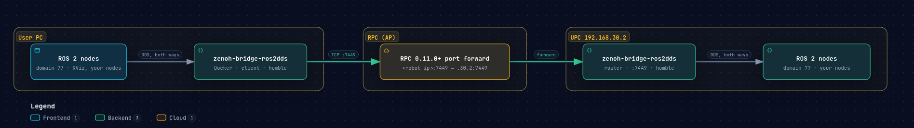
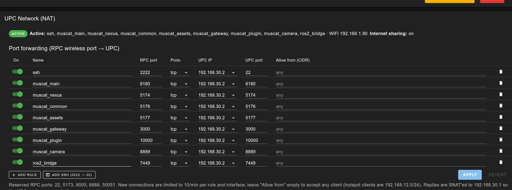

# UPC Topic Bridge

[Overview](01_overview.md) · [Driver](02_driver.md) · [Examples](03_examples.md) · [Description](04_description.md) · [Hardware Interface](05_hardware_interface.md) · [MoveIt](06_moveit.md) · [Tools](07_tools.md) · [UPC Topic Bridge](08_upc_topic_bridge.md)

How a user PC on the RPC's wireless network (its AP) uses the topics, services and actions of the nodes on the UPC.

> [!NOTE]
> Port forwarding came with the RPC update to **0.11.0**. With this version the UPC, too, communicates over the
> network through the RPC — through port 2222 (SSH) and the ports you forward.

## Overview

The UPC (192.168.30.2) sits on the robot's internal network, behind the RPC (192.168.30.1). A user PC joins the
RPC's wireless network and reaches the UPC only through the RPC's port forwarding (NAT) — SSH through RPC port
2222, for one. ROS 2 (DDS) does not pass this: its discovery is multicast, and its traffic uses many UDP ports that
change with every node.

`zenoh-bridge-ros2dds` carries it instead, over one TCP port. One bridge runs on the UPC and one on the user PC;
each joins the ROS 2 domain on its own side, and the two connect through one forwarded port, 7449. Every topic,
service and action of that domain then appears on the other side, as if the nodes ran there. The existing rules
(SSH 2222 and the others) stay as they are.



### Requirements

- **RPC 0.11.0 or later** — its web UI has the port forwarding rules used below. Update the RPC with the
  [RPC Updater](https://rainbowrobotics.github.io/rby1-dev/rpc_management_tools/rpc_updater.html).
- **The same `ROS_DOMAIN_ID` on both sides**, set in `~/.bashrc`: the nodes and the bridges all take it from
  there. This page uses 77; any number 2..101 that nothing else on the UPC or the network uses will do (not 0 or 1:
  see [Tips](#tips)).
- **`zenoh-bridge-ros2dds` 1.10.2 on both sides** — the same version.
- **Port 7449 on the UPC.** Ports 7447 and 7448 are taken by the bridges that come with the UPC's software.

## 1. RPC: forward port 7449



1. Open the RPC web UI in a browser.
2. Go to **Settings** (section *UPC Network (NAT)*, *Port forwarding*).
3. Click **ADD RULE**.
4. Fill the new row to forward port 7449:

   | Name | RPC port | Proto | UPC IP | UPC port | Allow from (CIDR) |
   |---|---|---|---|---|---|
   | `ros2_bridge` | `7449` | `tcp` | `192.168.30.2` | `7449` | empty (any client), or the user PC's address, e.g. `192.168.12.34/32` |

5. Click **APPLY**. The rule shows in *Active*.

## 2. UPC: run the bridge

Every command in this section is typed in a terminal on the UPC. From the user PC, log in to it by SSH through RPC
port 2222 (`<robot_ip>`: the RPC's address on its wireless network, e.g. `192.168.1.90`):

```bash
ssh -p 2222 nvidia@<robot_ip>
```

**Set the domain** — once; new terminals then have it:

```bash
echo 'export ROS_DOMAIN_ID=77' >> ~/.bashrc
source ~/.bashrc
echo $ROS_DOMAIN_ID     # 77
```

**Get the bridge** — the standalone build for the UPC's CPU (aarch64), from the
[zenoh-plugin-ros2dds 1.10.2 release](https://github.com/eclipse-zenoh/zenoh-plugin-ros2dds/releases/tag/1.10.2):

```bash
mkdir -p ~/zenoh_bridge && cd ~/zenoh_bridge
wget https://github.com/eclipse-zenoh/zenoh-plugin-ros2dds/releases/download/1.10.2/zenoh-plugin-ros2dds-1.10.2-aarch64-unknown-linux-gnu-standalone.zip
unzip zenoh-plugin-ros2dds-1.10.2-aarch64-unknown-linux-gnu-standalone.zip   # zenoh-bridge-ros2dds, libzenoh_plugin_ros2dds.so
```

**Write its settings** — `~/zenoh_bridge/upc_bridge.json5`:

```bash
cat > ~/zenoh_bridge/upc_bridge.json5 <<'EOF'
{
  plugins: {
    ros2dds: {
      deny: {
        publishers: ["/rosout", "/parameter_events"],
        subscribers: ["/rosout", "/parameter_events"],
      },
    },
  },
  mode: "router",
  listen: { endpoints: ["tcp/0.0.0.0:7449"] },
  scouting: { multicast: { enabled: false } },
}
EOF
```

| Setting | Meaning |
|---|---|
| (no `domain`) | The bridge joins the domain of `ROS_DOMAIN_ID`, as the nodes do. A `domain` here would be overridden by the variable anyway; with neither, it is 0 |
| `deny` | What is not carried. Here only the two topics every node has; everything else of the domain — publishers, subscribers, services, actions — is, both ways. `allow` instead carries only what it lists ([Tips](#tips)) |
| `mode`, `listen` | The UPC's bridge waits for the user PC's bridge on TCP 7449 |
| `scouting` | Off: it does not look for other bridges on the network (the UPC's own on 7447/7448) |

**Run it**, and leave it running:

```bash
cd ~/zenoh_bridge && ROS_DISTRO=humble ./zenoh-bridge-ros2dds -c upc_bridge.json5
```

It prints `Zenoh can be reached at: tcp/192.168.30.2:7449`, and `Route Publisher (ROS:/… -> …) created` for each
interface it carries.

## 3. User PC: connect to the UPC

**Set the domain** — the same number as on the UPC:

```bash
echo 'export ROS_DOMAIN_ID=77' >> ~/.bashrc
source ~/.bashrc
```

**Run the bridge** from its Docker image (the standalone build needs glibc 2.38, newer than Ubuntu 22.04's):

```bash
docker run -d --name zenoh_bridge_pc --net host -e ROS_DISTRO=humble -e ROS_DOMAIN_ID \
  eclipse/zenoh-bridge-ros2dds:1.10.2 client -e tcp/<robot_ip>:7449 --no-multicast-scouting
```

| Argument | Meaning |
|---|---|
| `--net host` | The bridge joins the PC's own network, where its ROS 2 nodes are |
| `-e ROS_DISTRO=humble` | The ROS 2 version of the nodes on this PC |
| `-e ROS_DOMAIN_ID` | Hands this terminal's `ROS_DOMAIN_ID` to the container (a container does not read `~/.bashrc`) |
| `client` | The mode (a plain argument in this version, not `-m`) |
| `-e tcp/<robot_ip>:7449` | The forwarded port of section 1 on the RPC (e.g. `tcp/192.168.1.90:7449`) |

`docker logs zenoh_bridge_pc` shows `New ROS 2 bridge detected` once it reaches the UPC's bridge. Stop it with
`docker rm -f zenoh_bridge_pc`.

## 4. Check the connection

A plain `hello` with the ROS 2 command line, both ways.

UPC → user PC:

```bash
# UPC
ros2 topic pub /bridge_hello std_msgs/msg/String "{data: hello from UPC}"
# user PC
ros2 topic echo /bridge_hello std_msgs/msg/String
```

User PC → UPC: the same, with the two commands swapped (`hello from PC`). Each `echo` prints `data: hello from …`
once a second. Stop both with Ctrl+C.

Where the ROS 2 demos are installed (`ros-humble-demo-nodes-cpp`), the talker and listener do the same, and a
service crosses as well:

```bash
ros2 run demo_nodes_cpp talker                 # one side
ros2 run demo_nodes_cpp listener               # the other: I heard: [Hello World: …]
ros2 run demo_nodes_cpp add_two_ints_server    # one side
ros2 service call /add_two_ints example_interfaces/srv/AddTwoInts "{a: 2, b: 3}"   # the other: sum=5
```

From then on the nodes you run on the UPC are used from the PC as if they ran there.

`ros2 node list` shows the bridge (`/zenoh_bridge_ros2dds`) rather than the UPC's nodes: on this PC the bridge
offers their interfaces. Nodes on this PC in the same domain — the driver too — are carried to the UPC the same
way.

## Tips

- **Same domain, set in every terminal**

  A terminal without `ROS_DOMAIN_ID` (one opened before `~/.bashrc` had it, a service, a cron job) runs its nodes —
  and a bridge — in domain 0. On the UPC domains 0 and 1 are used by its own software's bridges (Jazzy and Humble);
  a Humble node in domain 0 prints `sequence size exceeds remaining buffer`. Check with `echo $ROS_DOMAIN_ID` in the
  terminal before you start anything; a bridge started outside a terminal needs the variable set where it starts.

- **Carrying less**

  Replace `deny` with `allow` to carry only what it lists (regular expressions); the kinds it leaves out are not
  carried at all. Only two topics out of the UPC, for example:

  ```json5
  allow: { publishers: ["/chatter", "/tf_static"] },
  ```

  The kinds: `publishers`, `subscribers`, `service_servers`, `service_clients`, `action_servers`,
  `action_clients`.

- **Who can connect**

  Any client on the RPC's wireless network that reaches port 7449 joins domain 77 — and with everything carried, can
  call the driver's services and actions as well. To admit only your PC, set *Allow from (CIDR)* in the rule to its
  address.

- **Nodes on Jazzy**

  One bridge carries one domain of one ROS 2 version. For nodes on Jazzy (e.g. in a container with `--net host`),
  run a second pair: another domain and port (e.g. 7450, with its own forwarding rule), `ROS_DISTRO=jazzy`, and a
  Jazzy user PC or container on the other side.
