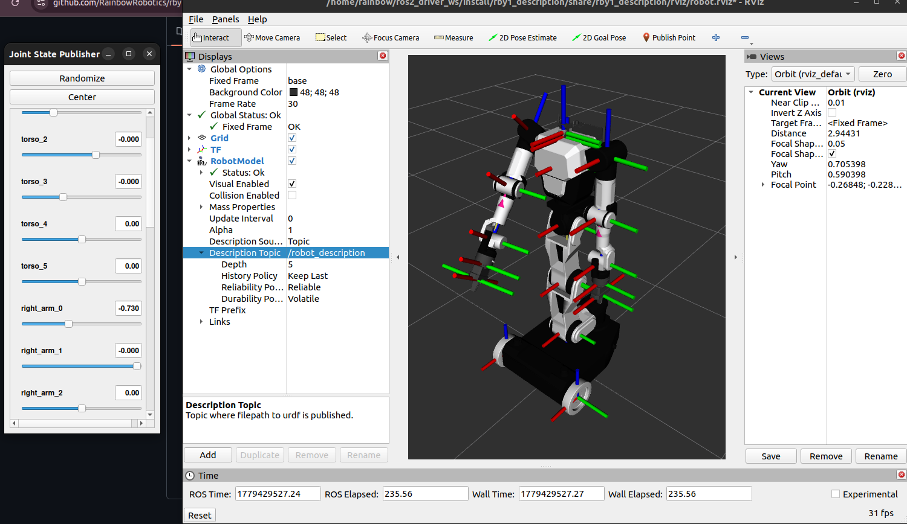
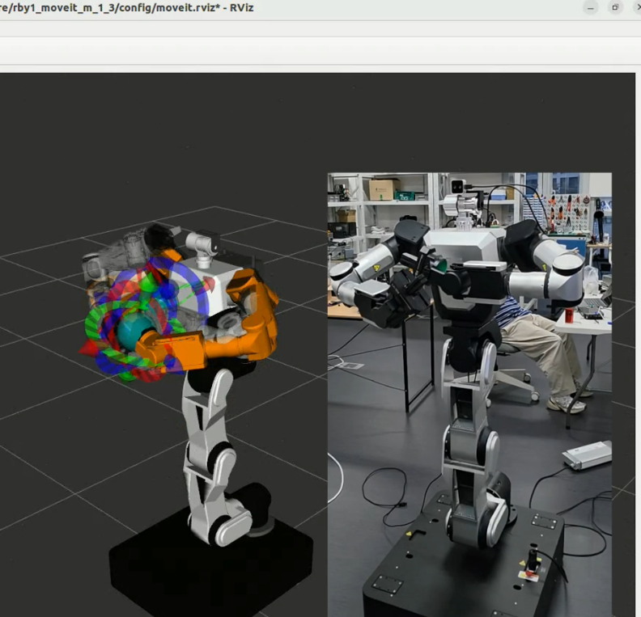

# RBY1 ROS 2 Driver Package

> [!CAUTION]
> ## For safe use, please test the features in a simulation first.

> [!NOTE]
> Questions, problems or requests about this driver: **rby.support@rainbow-robotics.com**

Please click the link below for more details.

[RBY1 ROS 2 Driver Documentation](https://rainbowrobotics.github.io/rby1-dev/ros2/ros2_driver.html)

## Overview

`rby1_ros2` is a unified ROS 2 driver package for controlling the Rainbow Robotics RBY1 robot.  
It wraps the RBY1 C++ SDK into a ROS 2 node, providing state monitoring and multiple control modes (Joint Position, Cartesian Position, Impedance, Gravity Compensation, and Trajectory Streaming) through a clean action/service/topic interface.

- **ROS 2 version**: Humble(recommend), Jazzy
- **OS**: Ubuntu 22.04 , 24.04
- **SDK compatibility**: rby1-sdk `0.10.x` and later

### System Architecture Overview


The system operates using two primary pipelines to interface with the robot:
1. **Direct Control Mode (`rby1_ros2_driver`)**: A standalone C++ ROS 2 node that communicates directly with the RBY1 robot or simulator via gRPC. User applications/scripts send standard ROS 2 topics, services, and actions (e.g. `robot_joint`, `robot_cartesian`) to command movements and monitor status.
2. **`ros2_control` Integration (`rby1_hardware`)**: Bridges `ros2_control` — with MoveIt 2, or its trajectory controllers alone — to the robot via a custom `RBY1SystemHardware` interface plugin. The hardware plugin streams command inputs to the robot via a direct gRPC connection, while querying status and coordinating power, servo states, and control rights with the `rby1_ros2_driver` node via internal ROS 2 service calls (like `/hardware_control`).

The manual, one page per topic: [Overview](Doc/manual/01_overview.md), [Driver](Doc/manual/02_driver.md), [Examples](Doc/manual/03_examples.md), [Description](Doc/manual/04_description.md), [Hardware Interface](Doc/manual/05_hardware_interface.md), [MoveIt](Doc/manual/06_moveit.md), [Tools](Doc/manual/07_tools.md).

---

## 1. Quick Start

- **If you install in an environment such as conda or miniforge, issues may arise due to Python and CMake path conflicts, so please install it in a local environment.**

### 1-1. Install ROS 2

Humble on Ubuntu 22.04 (recommended) or Jazzy on Ubuntu 24.04. The commands below say `humble`; on Jazzy write `jazzy`.

<https://docs.ros.org/en/humble/Installation/Ubuntu-Install-Debs.html>

### 1-2. Install RB-Y1 SDK

Build the C++ SDK from source as its README says: <https://github.com/RainbowRobotics/rby1-sdk>

`rby1_driver` and `rby1_hardware` find it through the environment variable `RBY1_SDK_PATH`, the SDK's source
tree with its build in `build/` (headers `include/rby1-sdk`, library `build/src`). The build stops with a message
if it is not set; put it in `~/.bashrc` (1-5):

```bash
export RBY1_SDK_PATH=$HOME/sdk/rby1-sdk    # where you cloned and built the SDK
```

### 1-3. Install RBY1 Simulator (Docker)

<https://hub.docker.com/r/rainbowroboticsofficial/rby1-sim>

### 1-4. Get the source and install its dependencies

```bash
mkdir -p rby1_ros2_ws/src
cd rby1_ros2_ws/src
git clone https://github.com/RainbowRobotics/rby1-ros2.git
cd ..

source /opt/ros/humble/setup.bash
sudo rosdep init        # once per PC; "already initialized" is fine
rosdep update
rosdep install --from-paths src --ignore-src -y
```

`rosdep` reads every `package.xml` in the workspace and installs what they declare as apt packages: MoveIt 2,
`ros2_control` with its controller manager, joint state broadcaster and joint trajectory controller, `cv_bridge`/OpenCV
and `librealsense2` (the camera publishers in `rby1_tools`). No MoveIt source build is needed, and the binaries also
work on the robot's UPC (Jetson).

```bash
# install check
ros2 pkg list | grep moveit
```

For an Intel RealSense (optional; a webcam does not need it), let a normal user open the camera — the ROS package does
not bring these rules:

```bash
sudo curl -sSL https://raw.githubusercontent.com/IntelRealSense/librealsense/v2.56.5/config/99-realsense-libusb.rules \
     -o /etc/udev/rules.d/99-realsense-libusb.rules
sudo udevadm control --reload-rules && sudo udevadm trigger
```

If `librealsense2` was missing when you built, the RealSense node is left out and the rest still works; after
installing it build the package again: `colcon build --symlink-install --packages-select rby1_tools`.

### 1-5. Environment Setup

Add the following lines to `~/.bashrc`:

```bash
sudo nano ~/.bashrc

# Add at the bottom:
export PATH=/opt/cmake/bin:$PATH
export RBY1_SDK_PATH=$HOME/sdk/rby1-sdk    # the SDK of 1-2
source /opt/ros/humble/setup.bash          # jazzy on Ubuntu 24.04

# Apply changes
source ~/.bashrc
```

## ROS domain (recommended on a shared network)

ROS 2 nodes see each other only when they have the same domain number (`ROS_DOMAIN_ID`, 0 when it is not set). If
other robots or PCs on the same network run ROS 2, their topics mix with this robot's. To keep this robot apart,
choose a number from 0 to 101 that nothing else on the network uses, and set it in one of two ways:

```bash
# for this terminal only: type it in every terminal you use
export ROS_DOMAIN_ID=30

# always: new terminals get it from ~/.bashrc
echo 'export ROS_DOMAIN_ID=30' >> ~/.bashrc
source ~/.bashrc
```

Everything that has to talk to the driver — examples, MoveIt, tools on another PC or in a container — needs the same
number. Check with `echo $ROS_DOMAIN_ID` (an empty line means 0) and `ros2 node list`, which shows
`/rby1/rby1_ros2_driver` from any terminal of the same domain.

### 1-6. Build

```bash
cd rby1_ros2_ws
colcon build --symlink-install
source install/setup.bash
```

### 1-7. Configure `driver_parameters.yaml`

Located at `rby1_driver/config/driver_parameters.yaml`.  
Edit this file to match your robot before launching the driver.  
Because the workspace was built with `--symlink-install`, **no rebuild is needed** after editing.

> [!IMPORTANT]
> If you use simulation for testing, keep `robot_ip: "127.0.0.1:50051"`.  
> Some state values (battery, tool flange FT/IMU) will show zeros in simulation because no physical sensors are attached.

These are all of its parameters (details, and the values fixed in the driver, in [Manual — Driver parameters](Doc/manual/02_driver.md#parameters)):

| Parameter | Default | Unit | Description |
|-----------|---------|------|-------------|
| `robot_ip` | `"127.0.0.1:50051"` | - | Robot IP address and gRPC port |
| `model` | `"m"` | - | Robot model — `"a"` (RBY1-A) or `"m"` (RBY1-M) |
| `stream_command_hz` | `30.0` | Hz | How often `cmd_vel` is expected; each `cmd_vel` is carried out for 1.1 of that period |
| `joint_position_command_cutoff_frequency` | `15.0` | Hz | Written to the robot at connect (robot parameter `joint_position_command.cutoff_frequency`): the joint position command filter. The robot's default |
| `cartesian_command_cutoff_frequency` | `15.0` | Hz | Written to the robot at connect (`cartesian_command.cutoff_frequency`): the Cartesian command filter. The robot's default |
| `default_acceleration_limit_scaling` | `1.0` | - | Written to the robot at connect (`default.acceleration_limit_scaling`): scales the acceleration limits of commands that give none, 0 to 1 |
| `default_velocity_limit_scaling` | `1.0` | - | Written to the robot at connect (`default.velocity_limit_scaling`): scales the velocity limits of commands that give none, 0 to 1 |
| `default_linear_acceleration_limit` | `20.0` | m/s² | Written to the robot at connect (`default.linear_acceleration_limit`): Cartesian commands' linear acceleration limit |
| `default_angular_acceleration_limit` | `10.0` | rad/s² | Written to the robot at connect (`default.angular_acceleration_limit`): Cartesian commands' angular acceleration limit |
| `se2_minimum_time` | `1.0` | s | Interpolation ramp of a `cmd_vel` (SE2 velocity) command |
| `se2_linear_acceleration_limit` | `0.5` | m/s² | Linear acceleration limit of `cmd_vel` commands |
| `se2_angular_acceleration_limit` | `0.5` | rad/s² | Angular acceleration limit of `cmd_vel` commands |
| `collision_threshold` | `0.02` | m | Minimum link distance below which a commanded pose is reported as a collision |
| `control_manager_unlimited` | `false` | - | Enable the control manager in unlimited mode: joint limits are not checked at enable, so a joint that stopped just outside its limit can be moved back. Also for a plain enable request |
| `publish_battery_state` | `true` | - | Enable battery state topic |
| `publish_tool_flange_state` | `true` | - | Publish the tool flange IMU and wrench topics (left + right). The flange status itself (connected, output voltage, switch) is always in `robot_state` |

> [!IMPORTANT]
> The six "written to the robot at connect" values are stored by the robot itself (SDK `SetParameter`), and the robot keeps them after the driver exits. They are the robot's own defaults as shipped. Drivers before 2026-10-26 wrote other values here (cutoff 4.71 and 1.5 Hz, linear acceleration 1.0 m/s²); the first connection of this driver replaces them.

Fixed in the driver (all of them in `rby1_driver/include/default_parameters.hpp`, with the reason for each value), not parameters: the state loop runs every 10 ms (100 Hz, the rate the robot provides its state); a command that leaves `minimum_time` at zero gets 2.0 s; the driver stops when state reads keep failing for 1.0 s; a trajectory whose first waypoint cannot be reached within the joints' velocity limits is rejected.

---

> [!NOTE]
> **State rate:**  
> The driver reads the robot state via `GetState()` and publishes all state topics every 10 ms (100 Hz, the rate the robot provides it).  
> Actual throughput may be slightly lower (97–100 Hz) depending on PC environment and CPU load.


### 1-8. Run Simulator (optional)

If you do not have a physical robot, run the Docker simulator.  
The robot IP in this case is `"127.0.0.1:50051"` or `"localhost:50051"`.  
Change the tag at the end to select a model/version (e.g. `a_v1.2`, `m_v1.3`).

```bash
# Example: Model A,  v1.2
sudo docker run --rm \
  -e DISPLAY=${DISPLAY} \
  -v /tmp/.X11-unix:/tmp/.X11-unix \
  -p 50051:50051 \
  rainbowroboticsofficial/rby1-sim:0.10.6-a_v1.2
```

> [!IMPORTANT]
> ## Model `a` only supports  up to v1.2. Model `m` supports v1.0–v1.3.

---

### 1-9. Launch the Driver

```bash
# In your workspace root
source install/setup.bash

ros2 launch rby1_driver rby1_ros2_driver.launch.py

# a robot or model other than the yaml's, without editing it
ros2 launch rby1_driver rby1_ros2_driver.launch.py robot_ip:=192.168.30.1:50051 model:=a
```

The driver publishes `odom → base_footprint` from the robot's odometry and, once, the static
`base_footprint → base` of the model (M: the same frame; A: `base` 0.228 m behind the wheel axle), so
the odometry and the robot model form one TF tree. Details: [Manual — Driver](Doc/manual/02_driver.md).

To start the MoveIt planner, its scene, MoveIt with `ros2_control`, or the camera together with the
driver, use `rby1_bringup` (next section); each part is described under [Launch or Run](#launch-or-run).

### 1-10. Bringup: the driver and what runs with it

`rby1_bringup` has one launch file that starts the driver and the parts you switch on. The switches are
`True`/`False` flags at the top of `rby1_bringup/launch/bringup.launch.py`, one line each with a comment;
**what each part starts with** is in `rby1_bringup/config/bringup.yaml`, one section per part with the
arguments of that part's own launch file (an empty value means that launch file's default).

```bash
ros2 launch rby1_bringup bringup.launch.py
```

| Flag | Starts | Its section in `bringup.yaml` |
|---|---|---|
| `DRIVER` (on) | the RB-Y1 driver | `driver`: `params_file`, `namespace`, `robot_ip`, `model` |
| `MOVEIT_EXECUTOR` | the MoveIt planner that moves the arms through the driver | `moveit_executor`: `rviz`, `velocity_scaling`, `minimum_time`, `impedance`, `ready_pose`, `version` |
| `MOVEIT_DEMO` | MoveIt with `ros2_control` (not together with the planner) | `moveit_demo`: `package`, `use_fake_hardware` |
| `ROS2_CONTROL` | `ros2_control` with the hardware plugin, without MoveIt (not together with `MOVEIT_DEMO`) | `ros2_control`: `use_fake_hardware` (which robot: the top of `rby1_hardware`'s launch file) |
| `SCENE` | obstacles loaded into the planning scene | `scene`: `config` |
| `OBJECTS` | modules on the robot or fixtures in the planning scene (the gripper is `GRIPPER`'s `scene`) | `objects`: `config` |
| `CAMERA` | the camera publisher | `camera`: `camera`, `config`, `source`, `intrinsics`, `mount` |
| `GRIPPER` | the gripper on the hands: its model on TF, its parts in the planning scene, a virtual or the real controller (v1.3: `model`/`scene` off, the controller feeds the robot model's finger joints; set `moveit_executor.version: 1.3`) | `gripper`: `model`, `scene`, `controller`, `hands`, `mount`, `config` |

Each part in the launch file is its own launch file included with its arguments written out, so a block can be copied or changed as it is. Details: [Manual — Bringup](Doc/manual/01_overview.md#bringup-rby1_bringup).

## Launch or Run

### Examples
Each example can be run in a **separate terminal** while the driver is active:
```bash
source install/setup.bash
ros2 run rby1_examples <example_name>
# ex ) ros2 run rby1_examples 01_power_control
```

| Example | What it does |
|---|---|
| `01_power_control` | Power ON/OFF and servo ON/OFF |
| `02_robot_status_monitor` | Prints the robot state (motors, brakes, battery, …) |
| `03_tool_flange_monitoring` | Prints the tool flange data |
| `04_joint_state_monitoring` | Prints the joint positions per part |
| `05_gravity_compensation` | Gravity compensation on and off |
| `06_zero_pose` | Moves every joint to 0 rad |
| `07_joint_command` | Ready pose: joint position (right arm), joint impedance (left arm) |
| `08_cartesian_command` | Ready pose, then a Cartesian target: cartesian position (right), cartesian impedance (left) |
| `09_multi_controls` | Joint and Cartesian control of different parts at once |
| `10_trajectory_joint_command` | A pre-computed trajectory through `follow_joint_trajectory` |
| `11_cancel_control` | Action cancel and the `cancel_control` service |
| `12_mobile_base_control` | Drives the mobile base with `cmd_vel` |
| `13_stream_command` | Zero and ready poses over the command streams (`stream_joint`), with varying waits |
| `14_collision_safety_control` | Watches the collision flag in the robot state and retreats to a safe pose when it is set |
| `15_cartesian_target_move` | Moves the hand to targets from `/rby1/right_arm/target_pose` with the driver alone: no planner, nothing is checked for collisions. Answers on `/rby1/right_arm/target_status` |
| `16_target_shuttle_publisher` | Publishes two hand poses in turn on that target topic, for example 15 (or the MoveIt planner below) to carry out |

What each example does in detail, its values and the stream channels the control examples use are in
[Manual — Examples](Doc/manual/03_examples.md), [Target examples (15, 16)](Doc/manual/03_examples.md#target-examples-15-16) and
[Manual — Command streams](Doc/manual/02_driver.md#command-streams).

### Visualization & Robot Description
You can use the robot's basic TF structure and state publisher through the commands below. When implementing features related to rby1, please use the model files from the corresponding package. Details: [Manual — Description](Doc/manual/04_description.md).



```bash
source install/setup.bash
ros2 launch rby1_description rby1_state_publisher.launch.py model:=a version:=1_1
```

### MoveIt 2



```bash
# open another terminal
source install/setup.bash

# Real hardware (default: use_fake_hardware:=false)
ros2 launch rby1_moveit_m_1_2 demo.launch.py

# or With a custom robot IP
# ros2 launch rby1_moveit_m_1_2 demo.launch.py robot_ip:=192.168.30.1:50051

# or Fake hardware / simulation (no real robot required)
# ros2 launch rby1_moveit_m_1_2 demo.launch.py use_fake_hardware:=true
```

Details: [Manual — MoveIt](Doc/manual/06_moveit.md#demolaunchpy); the planner and the scene below are in [Manual — Executor](Doc/manual/06_moveit.md#executor-rby1_moveit_executor), [Objects](Doc/manual/06_moveit.md#objects-rby1_moveit_objects) and [Scene](Doc/manual/06_moveit.md#scene).

#### Planner and planning scene (`rby1_moveit_executor`, `rby1_moveit_objects`)

> ⚠️ **Topic names changed.** The topics the tools below use between them were renamed so that everything of the robot
> is under `/rby1/` (target topics per arm, the marker topics, the tracking switch), and `rby1_moveit_scene` was merged
> into `rby1_moveit_objects`. If you have programs written against the earlier names, see the table in
> [Manual — Target interface](Doc/manual/06_moveit.md#target-interface).

A MoveIt planner that moves the arms through the driver, and the obstacles and modules of its planning scene.

| Package | What it does |
|---|---|
| `rby1_moveit_executor` | Plans with MoveIt (OMPL) to a tool pose target and executes through the driver's `follow_joint_trajectory` — no `ros2_control` |
| `rby1_moveit_objects` | Objects in the planning scene. The `scene` command adds, moves and removes obstacles (box, sphere, cylinder) and loads a file of them; `objects.launch.py` puts modules (gripper, sensors, tools) on robot links, or fixtures in the world, from a YAML file; `point_object.launch.py` keeps one obstacle where a point topic says |

A target is one message on `/rby1/right_arm/target_pose` (`/rby1/left_arm/target_pose` for the left arm): a
`std_msgs/Float64MultiArray` of 16 values, the row-major 4x4 pose of the tool frame in `base`. The executor answers on
`/rby1/right_arm/target_status` (`std_msgs/String`): `READY`, `PLANNING`,
`EXECUTING …`, `DONE`, or `FAILED: <reason and what to do>`. Any node on the same ROS domain can send one.
The planner serves both arms: a target for one arm moves that arm and leaves the other where it is, and targets sent
to both arms together move them in one motion.

A step-by-step guide — the planner with the publisher example, obstacles, modules on the robot, markers from a
camera — is in [Manual — Step by step](Doc/manual/06_moveit.md#step-by-step).

### `ros2_control` without MoveIt (`rby1_hardware`)

The hardware plugin `rby1_hardware/RBY1SystemHardware` is loaded by `ros2_control`, not by MoveIt, so the robot can
be driven through the standard `ros2_control` trajectory controllers alone. `rby1_hardware` has a launch file for
that: the controller manager (`ros2_control_node`) with the robot's URDF, `robot_state_publisher`, the
`joint_state_broadcaster` and the trajectory controllers. The driver must be running: the plugin takes the control
right from it (`/rby1/hardware_control`) and streams the joint positions to the robot itself. While it holds the
control right the driver refuses its own command sources (actions, stream, the examples); Ctrl+C on the launch
returns it.

**Which robot** it is for is set at the top of `rby1_hardware/launch/rby1_hardware.launch.py`, not on the command
line. Edit these three lines for your RB-Y1:

| Line | Meaning |
|---|---|
| `MOVEIT_CONFIG_PACKAGE` | `rby1_moveit_{a,m}_{1_0,1_1,1_2,1_3}`: the package whose URDF (with the `<ros2_control>` tag) and `config/ros2_controllers.yaml` are used. Only its files are read; nothing of MoveIt runs |
| `ROBOT_DESCRIPTION` | its `config/*.urdf.xacro`, e.g. `RBY1_M_v1_2.urdf.xacro` |
| `CONTROLLERS` | the controllers started active, from its `ros2_controllers.yaml`: `right_arm_controller`, `left_arm_controller`, `both_arms_controller`, `torso_controller`, `head_controller`, `body_controller` (v1.3 also `gripper_r_controller`, `gripper_l_controller`). Two active controllers cannot share a joint |

```bash
# terminal 1: the driver
ros2 launch rby1_driver rby1_ros2_driver.launch.py

# terminal 2
ros2 launch rby1_hardware rby1_hardware.launch.py
# ros2 launch rby1_hardware rby1_hardware.launch.py robot_ip:=192.168.30.1:50051   # a robot
# ros2 launch rby1_hardware rby1_hardware.launch.py use_fake_hardware:=true        # no robot, no driver (mock hardware)
```

| Argument | Default | Meaning |
|---|---|---|
| `robot_ip` | `127.0.0.1:50051` | robot address and gRPC port (the one the driver is connected to) |
| `driver_namespace` | `rby1` | namespace of the running driver |
| `use_fake_hardware` | `false` | `true`: `mock_components/GenericSystem` instead of the robot |

From then on it is plain `ros2_control`: joint states on `/joint_states`, a trajectory to
`/<controller>/follow_joint_trajectory` (`control_msgs/action/FollowJointTrajectory`) or `/<controller>/joint_trajectory`,
and `ros2 control list_controllers` / `ros2 control switch_controllers --deactivate right_arm_controller --activate both_arms_controller`
to change controllers at run time. Not together with a MoveIt `demo.launch.py` (one controller manager per robot).
In `rby1_bringup` this is the `ROS2_CONTROL` flag. Details: [Manual — Hardware Interface](Doc/manual/05_hardware_interface.md).

### `rby1_tools`

| Tool | Launch | What it does |
|---|---|---|
| `camera_publisher` | `camera.launch.py` | A webcam through OpenCV: the images, the camera model, and the camera's place on the robot on TF (`config/webcam.yaml`) |
| `realsense_publisher` | `camera.launch.py camera:=realsense` | An Intel RealSense through librealsense directly: the same, with depth and infrared when they are switched on (`config/realsense.yaml`) |
| gripper | `gripper.launch.py` | The RB-Y1 gripper on the hands, by flag: `model` (its URDF and meshes, `model/rby1_gripper/`, on TF under `ee_right`/`ee_left` for RViz), `scene` (its body and fingers as parts in the MoveIt planning scene, `model/rby1_gripper/gripper.yaml`), `controller` (`virtual`, `real` or `none`). Where it sits on each hand: `config/gripper_mount.yaml` |
| `virtual_gripper` | `gripper.launch.py controller:=virtual` | Stands in for a gripper driver: `/rby1/<hand>_gripper/command` (each finger's opening, m) and `/grasp` (true closes) in, the fingers' state out; nothing on the robot moves (`config/virtual_gripper.yaml`). On an RB-Y1 v1.3, whose robot model carries the gripper, `model:=false joint_states_topic:=/joint_states` feeds the model's finger joints |
| `gripper_driver` | `gripper.launch.py controller:=real` | The gripper itself through the SDK's Dynamixel bus (`/dev/rby1_gripper`, on the UPC), the same topics (`config/gripper_driver.yaml`). Built where `RBY1_SDK_PATH` is set. At start it homes each motor to both ends of its travel: the fingers move |

A marker detector is not part of this repository: any node works that publishes each marker as
`/rby1/marker_<id>/pose` (`geometry_msgs/PoseStamped` in the camera's optical frame) and as TF `target_marker_<id>`;
the RB-Y1 Isaac ROS repository has one (`rby1_apriltag`). Details in [Manual — Tools](Doc/manual/07_tools.md).

```bash
ros2 launch rby1_tools camera.launch.py                      # webcam, config/webcam.yaml
ros2 launch rby1_tools camera.launch.py camera:=realsense    # needs: sudo apt install ros-$ROS_DISTRO-librealsense2
ros2 launch rby1_tools camera.launch.py rviz:=true           # with RViz showing the image

ros2 launch rby1_tools gripper.launch.py                       # model on TF + virtual controller
ros2 launch rby1_tools gripper.launch.py scene:=true           # and its parts in the planning scene (needs a move_group)
ros2 launch rby1_tools gripper.launch.py controller:=real      # the gripper itself (on the UPC)
ros2 topic pub --once /rby1/right_gripper/grasp std_msgs/msg/Bool "{data: true}"         # close
ros2 topic pub --once /rby1/right_gripper/command std_msgs/msg/Float64 "{data: 0.05}"   # fully open: each finger's opening, m
```
